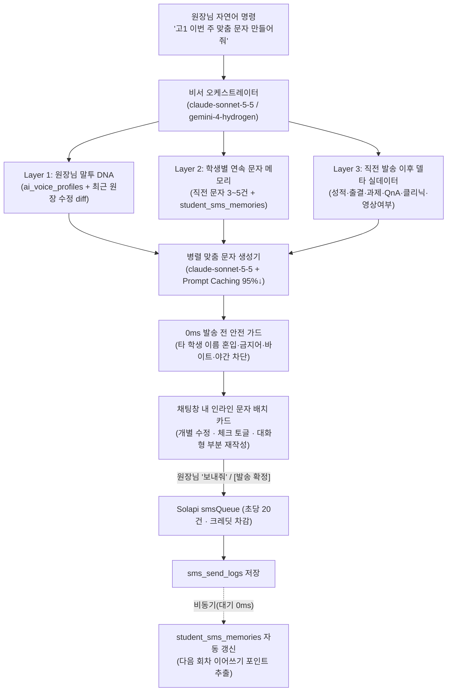

# 개인 AI 비서(닷츠 대체) & 학생맞춤 연속 문자 엔진 — 업데이트 계획

> 2026-11-23 작성. 대상 코드베이스: `my-teaching-assistant` (`server/routes/aiAssistant.js`, `client/src/pages/admin/AIAssistant.jsx`, `client/src/components/FloatingAIChat.jsx`, `server/services/smsQueue.js`, `server/utils/smsHelper.js`).
>
> **✅ 확정 방향 (2026-11-23):**
> 1. **기존 AI 어시스턴트를 페이지 내 '개인 AI 비서(닷츠 역할)'로 진화** — 별도 앱이나 챗지피티 닷츠로 오가지 않고, 우리 페이지 안에서 자연어로 시키면 바로 처리.
> 2. **요청 기반 실행 (On-Demand):** 원장님이 *"계성고 고1 이번 주 맞춤 문자 만들어줘"* → 초안 검토/대화형 수정(*"민준이만 좀 더 부드럽게 고쳐서 다 보내줘"*) → Solapi로 실제 발송(즉시 또는 예약).
> 3. **이전 문자 연속 참고 + 말투 유지:** 학생별 이전 발송 이력과 누적 메모리를 계속 참고해 자연스럽게 이어 쓰고, 원장님 고유의 말투를 고정·학습.
> 4. **자동 발송은 기본 체크 해제 (Opt-in 원칙):** 원장님의 명시적 발송 승인 없이 자동 발송되지 않도록 기본 OFF 유지.

---

## 1. 현재 어시스턴트 진단 & 먼저 고칠 기존 버그 6건

실제 [aiAssistant.js](file:///home/antigravity/kare1718/my-teaching-assistant/server/routes/aiAssistant.js)와 [AIAssistant.jsx](file:///home/antigravity/kare1718/my-teaching-assistant/client/src/pages/admin/AIAssistant.jsx)를 점검한 결과, 비서화 전에 반드시 해결해야 할 기존 결함이 확인됐다.

| # | 파일 · 위치 | 현재 문제 | 수정 방향 |
|---|---|---|---|
| 1 | `aiAssistant.js` L21, L510 | `bulk_sms` 액션이 `ACTION_TYPES`에만 선언되고 프롬프트·`executeAction()`에 미구현 | `draft_personalized_sms` + `send_sms_batch` + `remember_student_note` 3개 비서 액션 정식 구현 |
| 2 | `aiAssistant.js` L113, L137, L528, L586, L612, L627, L715 | PostgreSQL 앱에 SQLite 문법(`datetime('now')`, `date('now', '-1 day')`) 잔존 → 500 오류 | `NOW()`, `CURRENT_DATE - INTERVAL '1 day'` 등 PostgreSQL 표준으로 일괄 전환 |
| 3 | `aiAssistant.js` L610, L615 | `MAX(0, xp + ?)` (SQLite 함수) → PostgreSQL 500 오류 | `GREATEST(0, xp + ?)`로 수정 |
| 4 | `aiAssistant.js` L655, L740 | 없는 컬럼/테이블 참조(`s.phone` → 실제 `u.phone`/`s.parent_phone`, `FROM homeworks` → 실제 `homework`) | 실제 스키마(`users.phone`, `students.parent_phone`, `homework`)로 정합 |
| 5 | `AIAssistant.jsx` / `FloatingAIChat.jsx` | 대화가 React state에만 있어 새로고침 시 전부 소실, 말투·학생 메모 영구 저장 불가 | DB 스레드(`ai_assistant_threads`/`messages`) + 말투 프로필 + 학생별 메모리 영속화 |
| 6 | `aiAssistant.js` L366 | `callGemini` 단일 호출(토큰 제한)로 학생 15~30명 개별 문자 생성 시 절단·품질 저하 | `claude-sonnet-5-5` Prompt Caching 병렬 배치 생성 + SSE 진행률 스트리밍 |

---

## 2. 핵심 아키텍처 — "우리 페이지의 닷츠(dots)" 3-Layer 메모리



### Layer 1 — 원장님 말투 DNA 고정 & 자가 학습 (`ai_voice_profiles`, `ai_voice_edits`)
- **Few-shot 고정:** 원장님이 닷츠/문자로 실제 보냈던 모범 문자 **5~10개 원문**을 프로필에 등록(초기 1회 붙여넣기).
- **스타일 규칙 명시:** 호칭(`○○ 학생 학부모님`), 인사말 패턴, 권장 분량(LMS 350~650자), 이모지 사용 수준, 종결어미(`~습니다`/`~해요`), **항상 금지 규칙**(`AI`/`인공지능` 표기 금지, 타 학생 이름·비교 금지, 번역투 금지, 임상 말투 금지 — `student-report` 스킬 기준과 완전 동기화).
- **수정 diff 자동 학습:** 원장님이 초안을 수정한 뒤 발송하면 `(AI 초안 → 원장 수정본)` 쌍을 최근 5건까지 자동 저장해 다음 생성 프리픽스에 주입 → 쓸수록 원장님 말투에 정밀 수렴.

### Layer 2 — 학생별 연속 문자 메모리 (`student_sms_memories` + `sms_send_logs`)
- **직전 문자 원문 참조:** `sms_send_logs`에서 해당 학생에게 실제 발송된 최근 **3~5건**을 시간순으로 전달.
- **구조화 누적 메모리:** 매 발송 직후 비동기로 4개 필드를 업데이트:
  - `last_promised_action`: 지난 문자에서 학원/학생이 약속한 다음 계획 (예: *"비문학 구조도 주 3회 연습"*)
  - `ongoing_focus`: 현재 지속 관리 중인 약점/강점
  - `parent_tone_note`: 원장님이 비서에게 따로 알려준 학부모별 주의사항 (예: *"김민준 어머님은 점수 압박보다 격려 위주"*)
  - `last_opening_line`: 직전 문자의 첫 문장 (매주 같은 인사 반복 차단용 Anti-Repetition)
- **자연스러운 연속성:** *"지난주 말씀드렸던 비문학 구조 연습이 이번 주 독해 테스트(72→86점)에서 바로 성과로 이어졌습니다"*처럼 끊기지 않는 스토리 생성.

### Layer 3 — 직전 발송일 이후 델타 데이터 자동 수집
- 마지막 발송 시각(`last_sent_at`) 이후 새로 쌓인 데이터만 자동 집계:
  - **시험 성적(`scores` + `exams`)**: 직전 시험 대비 점수 변화 포함
  - **출결(`attendance`) · 과제(`homework_submissions`)**: **단, 영상 수강생(`learning_mode = 'video'`)이면 자동 생략**
  - **QnA 질문(`questions`)**: 학생이 스스로 남긴 핵심 질문 주제(예: *"음운 변동·서시 해석에 대해 4건 질문"* — 'AI' 표현 금지)
  - **클리닉(`clinic_appointments` + notes) · 상담/강사 메모(`consultation_logs`, `students.memo`)**

---

## 3. 대화형 비서 사용 시나리오 (닷츠처럼 쓰고, 그보다 정확하게)

| 단계 | 원장님 입력 (채팅 또는 플로팅 비서) | 비서 동작 |
|---|---|---|
| **1. 기억 입력** | *"김민준 어머님은 성적 얘기할 때 너무 딱딱하지 않게 써줘"* | `student_sms_memories.parent_tone_note` 영구 저장 + *"기억해 두었습니다"* 응답 |
| **2. 맞춤 초안 생성** | *"계성고 고1 이번 주 수업 후 학부모 문자 만들어줘"* | 대상 학생별 델타 데이터 + 직전 문자 3건 + 원장 말투 로드 → 병렬 생성 → 채팅창 안에 **학생별 편집·체크 가능한 문자 배치 카드** 출력 (예상 SMS/LMS 비용·크레딧 잔액 함께 표시) |
| **3. 대화형 부분 수정** | *"김민준은 클리닉 목요일 6시 확정된 것도 넣어주고, 박서연은 좀 더 짧게 다시 써줘"* | 2명만 즉시 재생성(나머지 학생은 유지) + 카드 실시간 갱신 |
| **4. 발송 실행** | *"체크된 14명 지금 보내줘"* 또는 *"오늘 저녁 7시에 예약 발송해줘"* | 최종 확인 요약(수신 인원·예상 크레딧·0ms 가드 통과 여부) → `[발송 확정]` 클릭 시 Solapi `smsQueue` 또는 `message_schedule` 등록 |
| **5. 사후 메모리 갱신** | *(자동 · 백그라운드)* | 발송 성공 건마다 `sms_send_logs` 기록 + `student_sms_memories` 자동 업데이트 + 원장 수정 diff 학습 |

---

## 4. 발송 전 0ms 안전 가드 (자동·일괄 발송 사고 제로화)

실제 학부모 휴대폰으로 나가는 문자이므로 LLM 판단에 맡기지 않고 **발송 직전 코드로 7가지를 강제 검사**한다.

1. **타 학생 이름 혼입 차단 (치명):** 학원 내 다른 재원생 이름이 A 학생 문자에 섞여 들어가면 즉시 발송 보류(경고 배지).
2. **금지어 차단:** `AI`, `인공지능`, `챗GPT`, `프롬프트`, `데이터베이스` 등 내부/금지 용어 탐지 시 차단.
3. **미치환 플레이스홀더 차단:** `{student_name}`, `[○○]`, `___` 등이 남아 있으면 차단.
4. **호칭 안전 체크:** 학부모 이름 직접 호명 대신 `"○○ 학생 학부모님"` 형식 확인.
5. **수신번호 & 수신동의 검증:** 전화번호 누락·형식 오류 사전 분리, 마케팅 유형일 때 `message_consent` 미동의자 자동 제외.
6. **바이트/요금 표시:** SMS(90B) vs LMS(2,000B) 자동 판별, 2,000B 초과 시 절단 경고, 발송 전 보유 SMS 크레딧 잔액 사전 확인.
7. **야간 발송 가드 (21:00 ~ 08:00 KST):** 야간 즉시 발송 시도 시 다음 날 09:00 예약 발송을 기본 제안(강제 즉시 발송은 명시적 확인 필요).

---

## 5. 2026-11 최신 Multi-API 분업 & 비용 설계

| 역할 | 추천 모델 (2026-11) | 선정 이유 & 효율 |
|---|---|---|
| **비서 의도 파악 · 도구 라우팅** | `gemini-4-hydrogen` 또는 `claude-sonnet-5-5` | 멀티턴 대화 맥락 + JSON 액션/부분 수정 정확도 |
| **학생별 맞춤 문자 본문 생성** | **`claude-sonnet-5-5`** (+ Prompt Caching) | 한국어 자연어 말투 유지력 최상. 원장님 말투 프리픽스 캐시 히트(\$0.10/MTok, 95%↓) → **학생 30명 일괄 생성 비용 약 \$0.04~0.08(약 60~110원)** |
| **발송 후 메모리 요약 (비동기)** | `gemini-3.5-flash-lite` 또는 `gpt-6-luna` | 초저가(\$0.10~\$0.30/MTok) · 대기시간 +0ms |
| **단일 키 폴백** | `gemini-4-hydrogen` / `gpt-6.2-sol` | `server/utils/qna/providers.js` 공용 어댑터 그대로 재사용(API `2026-10-21`·`thinkingLevel` 규격 통일) |

---

## 6. DB 스키마 계획 (`032_ai_secretary_sms.sql`)

```sql
-- 1. 원장님/강사 말투 프로필
CREATE TABLE IF NOT EXISTS ai_voice_profiles (
  id SERIAL PRIMARY KEY,
  academy_id INTEGER NOT NULL REFERENCES academies(id) ON DELETE CASCADE,
  user_id INTEGER REFERENCES users(id),
  name VARCHAR(100) NOT NULL DEFAULT '기본 학부모 안내 말투',
  is_default BOOLEAN NOT NULL DEFAULT TRUE,
  tone_rules TEXT,                  -- 호칭·종결어미·분량·금지 규칙
  sample_messages JSONB NOT NULL DEFAULT '[]'::jsonb, -- 기존 닷츠 모범 문자 5~10개
  learned_edits JSONB NOT NULL DEFAULT '[]'::jsonb,   -- 최근 원장 수정 diff 최대 5건
  created_at TIMESTAMPTZ DEFAULT NOW(),
  updated_at TIMESTAMPTZ DEFAULT NOW()
);

-- 2. 학생별 연속 문자 메모리 (이전 문자 기반 업데이트의 핵심)
CREATE TABLE IF NOT EXISTS student_sms_memories (
  id SERIAL PRIMARY KEY,
  academy_id INTEGER NOT NULL REFERENCES academies(id) ON DELETE CASCADE,
  student_id INTEGER NOT NULL REFERENCES students(id) ON DELETE CASCADE,
  last_sent_at TIMESTAMPTZ,
  last_message_preview TEXT,
  last_opening_line VARCHAR(200),   -- 반복 인사 방지
  last_promised_action TEXT,        -- 직전 문자에서 약속한 다음 계획
  ongoing_focus TEXT,               -- 지속 관리 포인트
  parent_tone_note TEXT,            -- 원장님이 지시한 학부모별 맞춤 메모
  updated_at TIMESTAMPTZ DEFAULT NOW(),
  UNIQUE (academy_id, student_id)
);

-- 3. 비서 생성 문자 배치 & 개별 초안 (대화형 부분 수정 · 검토 · 발송 추적)
CREATE TABLE IF NOT EXISTS ai_sms_draft_batches (
  id SERIAL PRIMARY KEY,
  academy_id INTEGER NOT NULL REFERENCES academies(id) ON DELETE CASCADE,
  created_by INTEGER REFERENCES users(id),
  thread_id INTEGER,
  voice_profile_id INTEGER REFERENCES ai_voice_profiles(id),
  prompt_summary TEXT,
  status VARCHAR(20) NOT NULL DEFAULT 'draft', -- 'draft' | 'partially_sent' | 'sent' | 'scheduled' | 'cancelled'
  scheduled_at TIMESTAMPTZ,
  created_at TIMESTAMPTZ DEFAULT NOW()
);

CREATE TABLE IF NOT EXISTS ai_sms_drafts (
  id SERIAL PRIMARY KEY,
  academy_id INTEGER NOT NULL REFERENCES academies(id) ON DELETE CASCADE,
  batch_id INTEGER NOT NULL REFERENCES ai_sms_draft_batches(id) ON DELETE CASCADE,
  student_id INTEGER NOT NULL REFERENCES students(id) ON DELETE CASCADE,
  recipient_role VARCHAR(20) NOT NULL DEFAULT 'parent', -- 'parent' | 'student' | 'both'
  recipient_phone VARCHAR(30),
  ai_draft TEXT NOT NULL,           -- AI 원안 (수정 diff 학습용)
  final_message TEXT NOT NULL,      -- 원장 수정 반영본
  data_snapshot JSONB DEFAULT '{}'::jsonb, -- 생성 근거(성적·출결·이전 문자 ID)
  guard_warnings JSONB DEFAULT '[]'::jsonb,
  is_selected BOOLEAN NOT NULL DEFAULT TRUE,
  status VARCHAR(20) NOT NULL DEFAULT 'draft', -- 'draft' | 'sent' | 'scheduled' | 'skipped' | 'failed'
  sent_at TIMESTAMPTZ,
  updated_at TIMESTAMPTZ DEFAULT NOW()
);

-- 4. 비서 개인 대화방 영속화 (새로고침해도 닷츠처럼 대화·문맥 유지)
CREATE TABLE IF NOT EXISTS ai_assistant_threads (
  id SERIAL PRIMARY KEY,
  academy_id INTEGER NOT NULL REFERENCES academies(id) ON DELETE CASCADE,
  user_id INTEGER NOT NULL REFERENCES users(id) ON DELETE CASCADE,
  title VARCHAR(120) DEFAULT '개인 비서 대화',
  active_batch_id INTEGER REFERENCES ai_sms_draft_batches(id),
  updated_at TIMESTAMPTZ DEFAULT NOW(),
  created_at TIMESTAMPTZ DEFAULT NOW()
);

CREATE TABLE IF NOT EXISTS ai_assistant_messages (
  id SERIAL PRIMARY KEY,
  academy_id INTEGER NOT NULL REFERENCES academies(id) ON DELETE CASCADE,
  thread_id INTEGER NOT NULL REFERENCES ai_assistant_threads(id) ON DELETE CASCADE,
  role VARCHAR(20) NOT NULL,        -- 'user' | 'assistant'
  content TEXT NOT NULL,
  payload JSONB DEFAULT '{}'::jsonb, -- 액션/초안 배치 ID/조회 테이블 스냅샷
  created_at TIMESTAMPTZ DEFAULT NOW()
);
```
*(기존 `018_rls_policies.sql`·`031`과 동일하게 위 6개 테이블 전부 `academy_id` RLS 정책 및 인덱스 적용)*

---

## 7. 단계별 구현 로드맵 (총 4~5일)

| 단계 | 공수 | 주요 산출물 | 완료 기준 |
|---|---:|---|---|
| **Phase 0 — 기존 비서 버그 수정** | 0.5일 | `aiAssistant.js` SQLite→PostgreSQL 문법 6건 수정 + `providers.js` 최신 모델 연동 | 기존 현황/시험/성적/공지/히든코드/클리닉 명령이 실 PostgreSQL 16에서 500 오류 0건 |
| **Phase 1 — DB · 말투 학습실 · 닷츠 이관** | 1일 | `032_ai_secretary_sms.sql`, 말투 프로필 CRUD, **기존 닷츠 문자 5~10개 붙여넣기 + 학생별 직전 문자 임포트**, 비서 대화방 영속화 | 새로고침 후 대화 유지, 닷츠 과거 문자 임포트 → `student_sms_memories` 시드 완료 |
| **Phase 2 — 연속 맞춤 문자 생성 엔진** | 1~1.5일 | `server/utils/secretary/smsDrafter.js`, `studentDelta.js`, `smsSafetyGuard.js`, 병렬 생성 + Prompt Caching | 20명 동시 생성 10초 내외, 이전 문자 내용 자연 연결, 영상 수강생 출결·과제 자동 제외, 0ms 가드 타 학생 이름 혼입 100% 차단 |
| **Phase 3 — 비서 인라인 배치 카드 & 발송 연동** | 1일 | `AIAssistant.jsx` & `FloatingAIChat.jsx` 개편: 채팅창 내 학생별 초안 카드(체크/인라인 수정/대화형 부분 재작성/즉시·예약 Solapi 발송) + `smsQueue` 연동 | *"고1 문자 만들어줘"* → *"민준이만 고쳐줘"* → *"보내줘"* 원스톱 완주, 예약 발송은 `message_schedule` 연동 |
| **Phase 4 — 메모리 자동 갱신 & 말투 학습 루프** | 0.5일 | 발송 완료 시 `student_sms_memories` 비동기 갱신 + 원장 수정본 `learned_edits` 자동 반영 + (선택) 주간 초안 자동 준비 루틴(**자동 발송 체크박스는 기본 OFF**) | 2회차 문자 생성 시 1회차 약속·수정 말투가 실제로 반영됨을 테스트로 확인 |
| **Phase 5 — 실 PostgreSQL + Solapi 드라이런 검증** | 0.5일 | `server/tests/ai-secretary-sms.test.js` + `audit-queries.js` + 실 DB E2E 검증 | 타 학생 이름 혼입 차단, 크레딧 부족 사전 차단, 야간 가드, 멀티테넌시 0 경고 통과 |

---

## 8. 닷츠에서 바로 갈아타기 위한 준비물 (원장님 확인)

1. **기존 닷츠 모범 문자 5~10개** (학생 이름만 가려서 복사·붙여넣기 → 1회 등록으로 말투 DNA 완성)
2. **발송 방식 확인:** 기본은 **대화형 요청 → 초안 카드 확인 → `[발송 확정]`(즉시 또는 예약)**으로 동작하며, *"초안만 매주 금요일에 미리 만들어두기"* 같은 선택 루틴도 기본 체크 해제(OFF) 상태로 제공.
3. **Solapi 발신번호 · 크레딧 확인:** 이미 연동된 Solapi(`SOLAPI_API_KEY` / `SOLAPI_SENDER`)를 그대로 사용하므로 별도 문자 업체 계약 불필요.
