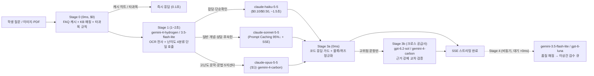

# AI QnA v2 전면 고도화 (1~3단계 완료 설계 및 구현 명세)

> 2026-11-23 작성. 대상 코드베이스: `my-teaching-assistant` / `academy-manager` (Express `server/` + React `client/`, PostgreSQL).
> 실제 1~3단계 전체 코드 구현은 `kare1718/my-teaching-assistant` 로컬 브랜치 `feat/qna-v2-all-stages` (`dcac9c3`, 21개 파일, 회귀 테스트 22/22 통과, SQL 테넌트 감사 0건, ESLint 0에러)에 완료되어 있다.

---

## 1. 1단계 — 코드 레벨 버그 & 실운영 파이프라인 결함 전면 봉합

### 1.1 코드 레벨 버그 8건 수정 (`my-teaching-assistant`)

| # | 버그 / 보안 결함 | 기존 문제 | 적용된 수정 |
|---|---|---|---|
| 1 | **`answer_guidelines` 미반영** | CRUD와 관리자 UI만 있고 `getGeminiAnswer()`에서 DB 조회 자체가 없었음 | `server/routes/questions.js`에서 활성 기준 로드 + `contextBuilder.js`의 학교/학년 스코프 필터로 시스템 프리픽스 최상단 주입 |
| 2 | **PostgreSQL `GROUP BY` 500 에러** | `GET /questions/summary`가 `SELECT s.id, u.name ... GROUP BY s.id`만 지정 | `GROUP BY s.id, u.name, s.school, s.grade` + `q.academy_id = s.academy_id` + `needs_teacher_count` 집계 추가 |
| 3 | **IDOR 보안 결함** | `GET /questions/status/:id`가 `student_id` 소유권 미검증 → 타 학생 답변 열람 가능 | `/status/:id` 및 신규 `/stream/:id` 모두 `WHERE id = ? AND student_id = ? AND academy_id = ?` 강제 |
| 4 | **PDF 업로드 시 400 에러** | multer가 `.pdf`를 허용하면서 Gemini에 `image/jpeg`로 고정 전송 | `providers.js`의 `detectMimeType()`으로 `application/pdf` 정확 판별(Gemini `inline_data`, Claude `document`, OpenAI `input_file` 각각 규격 준수) |
| 5 | **폴백 상태 오염 + 타임아웃 레이스** | 실패/60초 타임아웃 폴백이 `status = 'answered'`로 저장되어 미답변 목록에서 증발 + 102초 재시도와 충돌 | `status = 'needs_teacher'` 분리, 원자적 `WHERE answer IS NULL` + `settled` 가드, 자동 `qna_review_queue` 적재 |
| 6 | **DB 스키마 불일치** | `001_initial_schema.sql`은 `content/image_path/is_answered`, 라우트는 `question/image/status` 사용 + `answer_guidelines` 마이그레이션 누락 | `031_qna_v2_pipeline_blocks_quizzes.sql`에서 idempotent 백필·컬럼 추가·신규 4개 테이블 생성 |
| 7 | **한글 IME Enter 중복 전송** | `QnA.jsx` `handleKeyDown`에 `isComposing` 체크 부재 | `if (e.nativeEvent?.isComposing \|\| e.keyCode === 229) return;` 적용 + PDF 첨부 지원 |
| 8 | **SSE 압축 버퍼링 + 비용 폭주 방치** | `server.js`의 `compression()`이 SSE 스트림을 버퍼링 + `POST /questions` 빈도 제한/크레딧 연동 부재 | `text/event-stream` compression 제외, 학생별 5분 15건 rate limiter + graceful `aiCredits` 차감 연동 |

### 1.2 실운영 파이프라인 결함 5건 해결 (`academy-manager` 210건 감사 기준)

1. **검증기(verify) 오답 주입 영구 차단 (`server/utils/qna/verifier.js`)**
   - 검증기가 작가·작품·원문·연 구성 등 사실(`claim_type: "fact_check"`)을 뒤집어 수정(`revise`)하려면 반드시 제공된 KB 카드·강사 기준·이미지 전사본에 **실제로 존재하는 근거 문자열(`grounded_evidence`)**을 인용해야 한다.
   - 코드 레벨 락(`isEvidenceGrounded()`)이 코퍼스 대조에 실패하면 수정본 반영을 즉시 차단하고 초안을 유지한 채 `verification_status = 'ungrounded_hedged'` + `qna_review_queue` 적재. (정지용 「인동차」→김현승 오답 주입 재발 0건 보장)
2. **후속 채점 턴 기억 불일치 차단 (`server/utils/qna/contextBuilder.js`)**
   - `buildFollowUpHistory()`가 반드시 **최종 발송본 `q.answer`만** 사용하고 `draft_answer`와 폴백 메시지는 원천 배제.
3. **이미지 전사본 단절 차단 (`contextBuilder.js` + `pipeline.js` + `responseGuards.js`)**
   - Stage 1 OCR 전사본을 `questions.image_transcript`에 영구 저장하고 생성 턴·검증 턴·후속 턴에 모두 주입. 전사본 ≥40자 보유 시 "선지가 안 보인다" 회피 문구가 나오면 `IMAGE_TRANSCRIPT_IGNORED` 가드가 즉시 적발.
4. **교육과정 핵심 작품·문법 정답 카드 KB (`server/utils/qna/knowledgeCards.js` + `qna_knowledge_cards`)**
   - 감사에서 환각이 집중된 14종 핵심 시드 카드 내장: 정지용 「인동차」, 김소월 「길」/「진달래꽃」, 정철 「사미인곡」, 정지용 「향수」, 윤동주 「서시」, 최치원 「제가야산독서당」(오타 `제가야간독서당` 별칭 매핑), 이육사 「광야」, 김광섭 「성북동 비둘기」, 이상 「권태」, 수관형사 vs 수사(`다섯 사람`), 관형사 `다른` 이원 분석, 음운 변동 핵심, 반어 vs 역설 + 학원별 커스텀 카드 CRUD(학원 카드가 내장 카드보다 우선).
5. **피드백 루프 & 감사 추적성 복구**
   - 학생 👍/👎(`POST /:id/feedback`, 👎 시 자동 검수 큐 적재) · "선생님께 확인 요청"(`POST /:id/request-teacher`) · `draft_answer`/`verification_notes`/`revised_at`/`teacher_edited` 전 건 기록 · 관리자 검수 큐 UI.

---

## 2. 2단계 — 2026년 11월 최신 Multi-API 조합 & 효율 최적화

> **긴급 마이그레이션 주의:** `gemini-2.5-flash` 및 `gemini-2.5-pro`는 **2026-12-01 deprecated**(자동 라우팅 전환)되므로 즉시 Gemini 4 / 3.5-3.8 세대로 이관해야 한다. (`oxQuiz.js`, `gamification/utils.js`도 동일하게 추후 이관 권장)

### 2.1 최신 3사 API 카탈로그 (2026-11 검증 기준)

| 공급사 | 모델 ID | 입력 / 출력 (1M tok) | 캐시 히트 | 핵심 API 규격 주의사항 (미준수 시 400 에러) |
|---|---|---:|---:|---|
| **Google Gemini** | `gemini-3.5-flash-lite` | \$0.30 / \$2.50 | 0.1x | `thinkingLevel: 'MINIMAL'~'HIGH'` 지원, 초고속 비동기 감사·경량 처리 |
| **Google Gemini** | `gemini-3.8-flash` | \$0.75 / \$3.75 *(~12/31)* | 0.1x | `MINIMAL` 불가(`LOW`~`HIGH`) |
| **Google Gemini** | `gemini-4-hydrogen` | \$1.50 / \$7.50 | **0.05x** (95%↓) | **`thinkingBudget` 금지 → `thinkingLevel: 'LOW'\|'MEDIUM'\|'HIGH'\|'XHIGH'`**, sampling 파라미터(`temperature` 등) 생략, 환각 5배+ 감소, PDF·이미지·Office 네이티브 |
| **Google Gemini** | `gemini-4-neon` | \$3.00 / \$15.00 | **0.05x** | Hydrogen↔Carbon 중간 고추론 티어 |
| **Google Gemini** | `gemini-4-carbon` | \$4.00 / \$20.00 *(12/1~)* | **0.05x** | Google 프론티어 추론 모델 (`LOW`\|`MEDIUM`\|`HIGH`) |
| **Anthropic Claude** | `claude-haiku-5-5` | **\$0.10 / \$0.50** *(≤100K)* | 0.1x (\$0.01) | **`anthropic-version: 2026-10-21`에서 `temperature`/`top_p`/`top_k` 전송 시 400!** |
| **Anthropic Claude** | `claude-sonnet-5-5` | \$2.00 / \$10.00 | **0.05x** (\$0.10) | `thinking: {type:'disabled'}` 400 → `between_tools` 또는 `output_config.effort` 사용, `cache_control: {type:'ephemeral'}` |
| **Anthropic Claude** | `claude-opus-5-5` | \$4.00 / \$20.00 | **0.05x** (\$0.20) | Adaptive thinking 상시 활성(`thinking` 필드 생략 + `output_config.effort` 제어) |
| **Anthropic Claude** | `claude-fable-5-2` | \$8.00 / \$40.00 | **0.025x** (\$0.20) | 연구·장기 에이전트용(일반 QnA에는 과스펙) |
| **OpenAI GPT-6** | `gpt-6-luna` | **\$0.10 / \$0.50** | 0.05x | Responses API (`/v1/responses`), `reasoning.effort: 'none'~'high'` |
| **OpenAI GPT-6** | `gpt-6.1-terra` | \$1.00 / \$5.00 | 0.05x | 빠른 시각 추론·자연스러운 문장 |
| **OpenAI GPT-6** | `gpt-6.2-sol` | \$2.00 / \$10.00 | **0.05x** (\$0.10) | 적은 출력 토큰으로 다단계 추론 — **독립 교차 검증기 최적** |
| **OpenAI GPT-6** | `gpt-6.2-astra` | \$8.00 / \$40.00 | **0.05x** (\$0.40) | 시험기간 초고난도 교차 검증 프론티어 |

### 2.2 4단계 하이브리드 Multi-API 라우팅 (`server/utils/qna/pipeline.js`)

- **크로스 공급사 검증의 핵심 이점:** 생성이 Anthropic(`claude-opus-5-5`)이면 검증기는 자동으로 다른 공급사(`gpt-6.2-sol` 또는 `gemini-4-carbon`)를 우선 선택해 동일 모델 계열의 동조 편향을 줄이고, 장애(429/503/529) 시 타 공급사로 무중단 페일오버한다.
- **Prompt Caching 극대화 규칙:** 불변 코어 프롬프트 → 학원 `answer_guidelines` → 매칭된 KB 카드 순으로 시스템 프리픽스를 고정하고, 학생 이름·소속·첨부 원문 등 매 요청 바뀌는 정보는 마지막 `user` 메시지에만 배치한다.
- **환경변수 기반 Graceful Degradation:** 3사 키 모두 있으면 3사 최적 믹스, 1~2개 키만 있어도 역할별 체인이 자동으로 최선 모델을 선택하며 `QNA_*_MODEL`로 개별 오버라이드 가능.

---

## 3. 3단계 — 탈도식화 6종 답변 블록 & 8종 국어 인터랙티브 미니 퀴즈 연구

### 3.1 탈도식화 6종 답변 블록 (`AnswerBlockRenderer.jsx`)

| 블록 `type` | 목표 비중 | 적용 질문 유형 | 학생 UX 설계 |
|---|---:|---|---|
| `none` | **~35%** | 후속 턴(전체의 46%), 상담, 잡담, 짧은 개념 확인 | 블록 없이 깔끔한 대화체 3~6문장 + 인라인 볼드/코드/형광펜 |
| `choices` | ~15% | 5지선다 풀이, 오답 소거 | 정답 선지만 기본 펼침 + 오답 선지는 탭해서 지문 근거 확인 |
| `compare` | ~10% | 반어 vs 역설, 수사 vs 수관형사, 통사 vs 비통사 | 2열 대비 카드 + 하단 **⚡ 1초 판별 기준** 배너 |
| `step_diff` | ~10% | 음운 변동, 품사·문장 성분 분석 | 인라인 단계 변환 스트립(`국물` → `[궁물]`) + 어절별 품사 태그 |
| `quote_note` | ~10% | 시·소설·가사 작품 해석 | 원문 `<mark>` 하이라이트 + `[화자 정서]` `[표현법]` `[출제 포인트]` 칩 |
| `passage_map` | ~5% | 비문학(독서) 지문 독해 | 문단별 역할 태그(`[1문단 · 문제 제기]`) + 핵심 출제 문단 강조 |
| `flow` | **≤15%** | 3단계 이상 인과·서사 전개·정서 변화 **한정** | 세로 스택 고정, **최소 3~최대 5노드, 노드당 18자 제한**(위반 시 코드가 자동 제거/절단) |

여기에 공통 UX 2가지를 결합한다:
- **결론 1줄 + 접이식 심화 해설(`summary` + `detail`)**: 모바일 벽글 피로 해소.
- **단계적 힌트 게이트(`hint`)**: 시험 문제 사진 질문은 2줄 힌트를 먼저 보여주고 `[정답과 해설 바로 보기 ▾]` 1탭으로 전체 풀이를 열게 해 사고 습관 형성.

### 3.2 8종 국어 특화 인터랙티브 미니 퀴즈 연구 (`MiniQuizCard.jsx`)

**왜 "클라이언트 0ms 즉시 채점" 구조인가?**
1. 답변 생성 시 맨 끝 `qna-meta`에 정답·해설이 포함된 구조화 JSON을 함께 내려보내므로 **학생이 풀 때 추가 LLM 호출 비용이 0원**이고 응답 지연이 **0ms**다.
2. 기존 감사에서 가장 치명적이었던 **"채점 follow-up 턴에서 AI가 자기가 낸 선지를 다르게 기억하는 버그"**가 구조적으로 불가능하다.
3. 서버의 `sanitizeMiniQuiz()`가 인덱스 범위·중복 보기·빈칸(`___`) 누락을 사전 차단하므로 불량 문항이 학생 화면에 노출되지 않는다.
4. 풀이 결과(`is_correct`, `attempts_count`, `response_ms`)를 `qna_quiz_attempts`에 기록해 **학생별·유형별 취약 개념 데이터**가 자동 축적된다.

| # | 유형 (`type`) | 소요 시간 | 최적 국어 영역 | 교육적 효과 (왜 O/X보다 강한가?) | JSON 스키마 핵심 필드 |
|---|---|---:|---|---|---|
| 1 | **`ox`** (O/X 판별) | 5초 | 개념 오개념 즉각 교정 | 가장 낮은 진입장벽. "죽어도 아니 눈물 흘리우리다 = 역설이다 (X)"처럼 흔한 착각을 5초 안에 반박 | `{ prompt, answer: bool, explanation }` |
| 2 | **`choice2`** (2지선다 구분) | 8초 | 대립 개념 쌍 (반어/역설, 은유/직유) | 헷갈리는 두 개념 중 하나를 고르게 해 변별 기준을 즉각 인출(Retrieval Practice) | `{ prompt, options:[2], answerIndex, explanation }` |
| 3 | **`blank_chip`** (빈칸 칩 채우기) | 10초 | 문학 핵심 소재·원문·정의 암기 | 타이핑 부담 없이 칩 탭으로 핵심 키워드(예: 사미인곡 여름=`임의 옷`)를 문맥 속에 회상 | `{ prompt, template:"...___...", chips:[3~4], answer, explanation }` |
| 4 | **`transform`** (음운 변환 체크) | 10초 | 음운 변동 (비음화·유음화·구개음화·축약) | 원형 단어(`밥만`) + 규칙 힌트(`ㅂ+ㅁ`) → 실제 표준 발음(`[밤만]`)을 직접 적용해 규칙 전이 확인 | `{ prompt, sourceWord, ruleHint, options:[3~4], answerIndex, explanation }` |
| 5 | **`spot_error`** (틀린 구절 탭하기) | 12초 | 내신 선지 오답 소거 · 문법/맞춤법 판별 | 수동으로 정답을 고르는 대신 **오류 지점을 직접 찾아 찌르는** 능동 탐색 — 실제 시험의 오답 판별 훈련과 직결 | `{ prompt, tokens:[4~7], errorIndex, correction, explanation }` |
| 6 | **`match_pair`** (2×2 / 3×3 짝짓기) | 15초 | 작품↔작가, 계절↔소재, 표현법↔예문 | 다중 개념 간 혼동(정지용·김소월·윤동주, 춘하추동 소재)을 한 번에 정리하는 최강의 인출 훈련 | `{ prompt, pairs:[{left, right} 2~3], explanation }` |
| 7 | **`order_sort`** (순서 조립 체크) | 15초 | 서사 전개 · 비문학 인과 · 복합 음운 변동 순서 | **도식화(`flow`)의 완벽한 능동 대체!** 화살표 그림을 눈으로만 보는 대신 `대표음화→ㄴ첨가→비음화` 순서를 직접 조립 | `{ prompt, correctOrder:[3~4], explanation }` |
| 8 | **`classify_bucket`** (분류 바구니) | 15초 | 품사 통용(수사/수관형사, 관형사/형용사), 표현법 분류 | 내신 최고 빈출 함정("다섯 사람" vs "다섯이 모였다")을 3~4개 예문 동시 분류로 완벽 격파 | `{ prompt, buckets:[2], items:[{text, bucketIndex} 3~4], explanation }` |

**출제 품질 안전 규칙 (프롬프트 + 코드 이중 강제):**
- 설명 본문에서 예시로 든 **똑같은 문장·단어**를 정답으로 재사용하지 않고, 원리를 응용한 새로운 예문으로 출제(감사 754번 "국물 설명하고 국물 출제" 결함 방지).
- 후속 대화·상담·잡담에는 미니 퀴즈를 붙이지 않고, 개념 설명·문제 풀이 첫 턴의 약 50~60%에만 선택적으로 붙여 피로도 방지.

---

## 4. 구현 완료 파일 목록 & 배포 체크리스트

### 구현 완료 내역 (`kare1718/my-teaching-assistant`, 브랜치 `feat/qna-v2-all-stages`, 커밋 `dcac9c3`)
- **DB 마이그레이션:** `server/db/migrations/031_qna_v2_pipeline_blocks_quizzes.sql`
- **백엔드 QnA v2 엔진 (`server/utils/qna/`):** `models.js`, `providers.js`, `knowledgeCards.js`, `contextBuilder.js`, `blocksAndQuizzes.js`, `responseGuards.js`, `verifier.js`, `streamBus.js`, `asyncAuditor.js`, `pipeline.js`
- **백엔드 라우트·서버:** `server/routes/questions.js`, `server/server.js` (SSE compression 제외), `server/utils/geminiHelper.js` (deprecated `gemini-2.0-flash` → 최신 모델 업그레이드), `server/.env.example`
- **프론트엔드 UX:** `client/src/components/qna/AnswerBlockRenderer.jsx`, `client/src/components/qna/MiniQuizCard.jsx`, `client/src/pages/student/QnA.jsx`, `client/src/pages/admin/QnAManage.jsx`
- **자동 테스트:** `server/tests/qna-v2.test.js` (`npm run test:qna` — **22/22 통과**), `npm run audit:queries` (**테넌트 누락 0건**), JSX ESLint (**0 에러**)

### 배포 시 확인 항목
1. Render/서버 환경변수에 보유한 공급사 키(`GEMINI_API_KEY`, `ANTHROPIC_API_KEY`, `OPENAI_API_KEY`) 등록 (1개 이상이면 즉시 동작, 3개 모두 등록 시 크로스 공급사 검증 활성화).
2. 서버 재시작 시 `031_qna_v2_pipeline_blocks_quizzes.sql` 자동 적용 확인.
3. 관리자 `질문 관리 → 작품KB`에서 학원 내신 시험 범위 작품 카드 5~10개 추가 등록.
4. `server/routes/oxQuiz.js` 및 `server/routes/gamification/utils.js`의 `gemini-2.5-flash`도 2026-12-01 이전에 `gemini-4-hydrogen` 또는 `gemini-3.5-flash-lite`로 순차 이관 권장.
