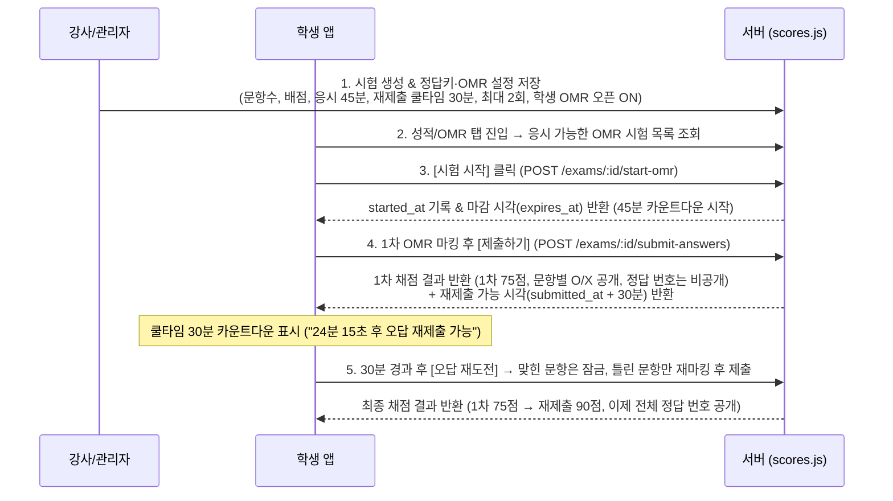

# 학생 직접 OMR 카드 입력 & 타이머·재제출 시스템 — 구현 계획 및 완료 명세

> 2026-11-23 작성. 대상 코드베이스: `my-teaching-assistant` / `academy-manager` (강인한국어 페이지, Express `server/` + React `client/`, PostgreSQL).
> (멀티테넌트 키는 `my-teaching-assistant`의 `academy_id` / `academy-manager`의 `tenant_id`, 마이그레이션은 `server/db/migrations/*.sql` 또는 `server/db/migrations.js` 규약에 맞춰 적용한다.)
> 실제 전체 코드 구현은 `kare1718/my-teaching-assistant` 로컬 브랜치 `feat/student-omr-system` (`277b68d`, 5개 파일, 프론트엔드 프로덕션 빌드 검증 통과, OMR 채점·쿨타임·마스킹 단위 테스트 4/4 통과)에 완료되어 있다.
>
> **✅ 확정 및 구현 완료 (2026-11-23):**
> 1. **관리자 시험별 맞춤 세팅:** 문항 수 · 선지 수(3/4/5지선다) · 배점(균등/문항별) · 빠른 정답 문자열 입력 · **시험 응시 제한 시간(분)** · **재제출 대기 시간(쿨타임, 분)** · 최대 제출 횟수 · 학생 OMR 오픈 여부를 관리자가 시험마다 직접 설정.
> 2. **단계별 결과/정답 공개 (베끼기 방지):** 재제출 기회가 남아 있을 때는 **점수와 문항별 정오(O/X)** 만 보여주고 실제 정답 번호는 서버에서 `null`로 마스킹. 재제출이 모두 끝난 뒤(또는 만점 달성·최종 확정 후) 실제 정답 번호 공개.
> 3. **오답 잠금 재도전 & 1차·재제출 성적 이중 기록:** 재제출 시 **1차에 맞힌 문항은 정답 상태로 잠금 유지**하고 **틀린 문항만 다시 마킹**해 제출. 성적에는 **1차 원점수와 재제출 점수를 모두 기록**(`1차 75점 → 재제출 90점`).

---

## 1. 배경과 현재 코드베이스 진단

현재 `my-teaching-assistant`에는 관리자용 정답키 입력과 관리자 대리 OMR 입력(`ScoreInput.jsx` → `OMR 입력` 탭)의 초기 골격이 있으나, **학생이 앱에서 직접 OMR을 풀고 제출·재제출하는 흐름은 비어 있거나 동작하지 않는 상태**다.

| 영역 | 현재 구현 상태 | 문제점 / 누락 사항 | 주요 파일 |
|---|---|---|---|
| **DB 마이그레이션** | `001_initial_schema.sql`에 `exams`, `scores`만 정의됨 | `exam_answer_keys`, `student_answers` 테이블 생성 DDL이 마이그레이션 파일(`001`~`030`)에 누락되어 있음. 타이머·쿨타임·1차/재제출 분리 컬럼 없음 | `server/db/migrations/` |
| **정답키 보안** | `GET /scores/exams/:examId/answer-key`에 `authenticateToken`만 적용 | `requireAdmin`이 없어 **학생 권한으로도 정답키 전체(정답 번호)를 사전 조회 가능**한 보안 취약점 존재 | `server/routes/scores.js` |
| **학생 시험 노출** | `GET /scores/my-scores`가 `scores JOIN exams`로만 조회 | 관리자가 성적을 먼저 입력하기 전에는 학생 화면(`ScoreView.jsx`)에 응시할 시험 자체가 뜨지 않음 | `server/routes/scores.js`, `client/src/pages/student/ScoreView.jsx` |
| **학생 OMR 입력 UI** | 없음 (제출 후 결과 열람용 코드만 일부 존재) | 학생이 직접 번호를 마킹·제출·재제출할 수 있는 OMR 카드 화면 및 타이머 UI가 없음 | `client/src/pages/student/ScoreView.jsx` |
| **결과 조회 데이터 불일치** | `GET /my-submission`은 평면 객체(`{ answers, answerKey }`) 반환 | `ScoreView.jsx`는 `omrData.submission.answers`(배열)와 `omrData.answerKey` 중첩 구조를 기대해 기존 OMR 결과 보기조차 렌더링되지 않음 | `server/routes/scores.js`, `client/src/pages/student/ScoreView.jsx` |
| **타이머 & 재제출 제한** | `POST /submit-answers` 호출 시 제한 없이 즉시 덮어쓰기 | 시험 응시 제한 시간(카운트다운), 재제출 쿨타임(대기 시간), 최대 제출 횟수 제한, 1차 점수 보존 로직이 전혀 없음 | `server/routes/scores.js` |

---

## 2. 핵심 설계 원칙

1. **서버 기준 시간 검증 (Server-Authoritative Timer & Cooldown)**
   - 프론트엔드 타이머만으로는 새로고침·시계 조작을 막을 수 없으므로, 서버 DB에 `started_at`(응시 시작 시각)과 `last_submitted_at`(직전 제출 시각)을 기록하고 서버에서 남은 응시 시간과 재제출 가능 시각(`next_retry_available_at`)을 검증한다.
   - 네트워크 지연을 고려해 응시 제한 시간 검증 시 **60초의 유예 시간(Grace Period)** 을 둔다.
2. **정답 번호 서버 마스킹 (Anti-Cheat)**
   - 학생이 아직 재제출 가능 횟수가 남아 있고 만점이 아닌 경우, 서버 응답에서 문항별 `isCorrect`(`true`/`false`)만 내려주고 **`correctAnswer`는 `null`로 마스킹**한다. 프론트에서 숨기는 것이 아니라 네트워크 탭으로도 정답을 볼 수 없게 차단한다.
3. **맞힌 문항 잠금 + 오답만 재마킹 (Wrong-Only Retry)**
   - 재제출 시 이전 회차에서 맞힌 문항은 서버와 UI 모두에서 기존 정답 마킹을 고정(Lock)하고, 틀린 문항만 새로 마킹해 제출받는다. (관리자 설정으로 '전체 문항 다시 풀기' 모드도 선택 가능하되 기본값은 `'wrong_only'`).
4. **1차 원점수 & 재제출 점수 이중 보존**
   - 재제출 시 1차 점수를 덮어써서 지우지 않는다.
   - **1차 점수(`first_score`)** 는 학생의 초기 실력 지표 및 공정한 석차(등수) 산정 기준으로 영구 보존하고, **재제출 점수(`retest_score` / `final_score`)** 는 오답 클리닉·성취도 지표로 함께 기록한다.
5. **Opt-in 오픈 (관리자 명시적 활성화)**
   - 정답키를 등록 중이거나 아직 시험 시작 전인 시험이 학생 앱에 바로 노출되지 않도록 `student_omr_enabled`(기본 `false`, 또는 관리자가 정답키 저장 시 체크)로 공개 시점을 제어한다.

---

## 3. 사용자 흐름 (User Flow)



---

## 4. 단계별 구현 계획

### Phase 1 — DB 스키마 & 마이그레이션 정비 (0.5일)

신규 마이그레이션 파일 `server/db/migrations/031_student_omr_system.sql` 생성 (기존 테이블 누락 보완 + OMR 설정 및 이력 컬럼 추가):

```sql
-- 1. exams 테이블 누락 컬럼 보완 (기존 환경 호환)
ALTER TABLE exams
  ADD COLUMN IF NOT EXISTS max_score NUMERIC DEFAULT 100,
  ADD COLUMN IF NOT EXISTS exam_date DATE,
  ADD COLUMN IF NOT EXISTS exam_end_date DATE,
  ADD COLUMN IF NOT EXISTS grade_cuts TEXT,
  ADD COLUMN IF NOT EXISTS academy_id INTEGER;

-- 2. exam_answer_keys 테이블 생성 및 OMR 세팅 컬럼 추가
CREATE TABLE IF NOT EXISTS exam_answer_keys (
  id                          SERIAL PRIMARY KEY,
  exam_id                     INTEGER NOT NULL REFERENCES exams(id) ON DELETE CASCADE,
  academy_id                  INTEGER NOT NULL,
  question_count              INTEGER NOT NULL DEFAULT 20,
  choice_count                INTEGER NOT NULL DEFAULT 5,
  answer_key                  TEXT NOT NULL,                 -- JSON: { numQuestions, numChoices, scoringType, maxScore, defaultPoints, questions: [{num, answer, points}] }
  point_config                TEXT DEFAULT 'equal',
  -- 신규: 학생 직접 OMR & 시간/재제출 세팅
  student_omr_enabled         BOOLEAN NOT NULL DEFAULT false, -- 학생 앱 OMR 입력 오픈 여부 (기본 OFF)
  time_limit_minutes          INTEGER DEFAULT NULL,           -- 시험 응시 제한 시간(분), NULL 또는 0이면 제한 없음
  allow_resubmit              BOOLEAN NOT NULL DEFAULT true,  -- 재제출 허용 여부
  resubmit_cooldown_minutes   INTEGER NOT NULL DEFAULT 30,    -- 1회 제출 후 재제출 대기 시간(분), 0이면 즉시 가능
  max_attempts                INTEGER NOT NULL DEFAULT 2,     -- 총 제출 가능 횟수 (1=재제출 불가, 2=1차+재제출 1회, 0=무제한)
  resubmit_mode               VARCHAR(20) NOT NULL DEFAULT 'wrong_only', -- 'wrong_only'(오답만 재마킹) | 'all'(전체 재마킹)
  reveal_answers_policy       VARCHAR(20) NOT NULL DEFAULT 'after_final', -- 'after_final'(재제출 완료 후 정답공개) | 'immediate'(즉시 공개) | 'never'(비공개)
  created_at                  TIMESTAMPTZ DEFAULT NOW(),
  updated_at                  TIMESTAMPTZ DEFAULT NOW(),
  UNIQUE(exam_id, academy_id)
);

ALTER TABLE exam_answer_keys
  ADD COLUMN IF NOT EXISTS student_omr_enabled       BOOLEAN NOT NULL DEFAULT false,
  ADD COLUMN IF NOT EXISTS time_limit_minutes        INTEGER DEFAULT NULL,
  ADD COLUMN IF NOT EXISTS allow_resubmit            BOOLEAN NOT NULL DEFAULT true,
  ADD COLUMN IF NOT EXISTS resubmit_cooldown_minutes INTEGER NOT NULL DEFAULT 30,
  ADD COLUMN IF NOT EXISTS max_attempts              INTEGER NOT NULL DEFAULT 2,
  ADD COLUMN IF NOT EXISTS resubmit_mode             VARCHAR(20) NOT NULL DEFAULT 'wrong_only',
  ADD COLUMN IF NOT EXISTS reveal_answers_policy     VARCHAR(20) NOT NULL DEFAULT 'after_final',
  ADD COLUMN IF NOT EXISTS updated_at                TIMESTAMPTZ DEFAULT NOW();

-- 3. student_answers 테이블 생성 및 1차/재제출·타이머 컬럼 추가
CREATE TABLE IF NOT EXISTS student_answers (
  id                  SERIAL PRIMARY KEY,
  exam_id             INTEGER NOT NULL REFERENCES exams(id) ON DELETE CASCADE,
  student_id          INTEGER NOT NULL REFERENCES students(id) ON DELETE CASCADE,
  academy_id          INTEGER NOT NULL,
  -- 현재(최신) 제출 데이터 (NULL이면 시험 시작만 하고 미제출 상태)
  answers             TEXT,
  score               NUMERIC,
  correct_count       INTEGER,
  submitted_at        TIMESTAMPTZ,
  -- 1차 제출 원점수·답안 보존
  first_answers       TEXT,
  first_score         NUMERIC,
  first_correct_count INTEGER,
  first_submitted_at  TIMESTAMPTZ,
  -- 타이머 & 제출 횟수 제어
  started_at          TIMESTAMPTZ,                           -- 현재 응시 시작 시각 (응시 제한 시간 계산용)
  draft_answers       TEXT,                                  -- 임시 저장 답안 (타이머 만료/재접속 복구용)
  attempt_count       INTEGER NOT NULL DEFAULT 0,            -- 누적 제출 횟수 (0=응시중, 1=1차제출 완료, 2=재제출 완료...)
  is_finalized        BOOLEAN NOT NULL DEFAULT false,        -- 더 이상 재제출 불가(만점 또는 횟수 소진 또는 포기 확정)
  UNIQUE(exam_id, student_id, academy_id)
);

ALTER TABLE student_answers
  ADD COLUMN IF NOT EXISTS first_answers       TEXT,
  ADD COLUMN IF NOT EXISTS first_score         NUMERIC,
  ADD COLUMN IF NOT EXISTS first_correct_count INTEGER,
  ADD COLUMN IF NOT EXISTS first_submitted_at  TIMESTAMPTZ,
  ADD COLUMN IF NOT EXISTS started_at          TIMESTAMPTZ,
  ADD COLUMN IF NOT EXISTS draft_answers       TEXT,
  ADD COLUMN IF NOT EXISTS attempt_count       INTEGER NOT NULL DEFAULT 0,
  ADD COLUMN IF NOT EXISTS is_finalized        BOOLEAN NOT NULL DEFAULT false;

-- 기존 데이터 백필 (이미 제출된 1차 데이터를 first_* 에 복사)
UPDATE student_answers
SET first_answers = answers,
    first_score = score,
    first_correct_count = correct_count,
    first_submitted_at = submitted_at,
    attempt_count = CASE WHEN answers IS NOT NULL THEN 1 ELSE 0 END
WHERE first_score IS NULL AND answers IS NOT NULL;

-- 4. 회차별 상세 제출 이력 테이블 (1차, 2차, N차 로그 보존)
CREATE TABLE IF NOT EXISTS student_answer_attempts (
  id               SERIAL PRIMARY KEY,
  exam_id          INTEGER NOT NULL REFERENCES exams(id) ON DELETE CASCADE,
  student_id       INTEGER NOT NULL REFERENCES students(id) ON DELETE CASCADE,
  academy_id       INTEGER NOT NULL,
  attempt_num      INTEGER NOT NULL,                         -- 1, 2, ...
  answers          TEXT NOT NULL,
  score            NUMERIC NOT NULL,
  correct_count    INTEGER NOT NULL,
  duration_seconds INTEGER,                                  -- 응시 시작 ~ 제출까지 소요 시간(초)
  submitted_by     VARCHAR(20) NOT NULL DEFAULT 'student',   -- 'student' | 'admin'
  submitted_at     TIMESTAMPTZ NOT NULL DEFAULT NOW()
);

CREATE INDEX IF NOT EXISTS idx_answer_attempts_exam_student
  ON student_answer_attempts (academy_id, exam_id, student_id, attempt_num);

-- 5. scores 테이블에 1차 점수 / 재제출 점수 컬럼 보완
ALTER TABLE scores
  ADD COLUMN IF NOT EXISTS rank_num     INTEGER,
  ADD COLUMN IF NOT EXISTS note         TEXT,
  ADD COLUMN IF NOT EXISTS status       VARCHAR(30) DEFAULT 'normal',
  ADD COLUMN IF NOT EXISTS first_score  NUMERIC,             -- OMR 1차 원점수
  ADD COLUMN IF NOT EXISTS retest_score NUMERIC;             -- OMR 재제출 최종 점수
```

---

### Phase 2 — 백엔드 API 설계 (`server/routes/scores.js`) (1~1.5일)

#### 2.1 관리자용 정답키 & OMR 세팅 API 확장
- **`POST /scores/exams/:examId/answer-key`** (관리자 전용 `requireAdmin`):
  - 요청 바디 확장:
    ```json
    {
      "numQuestions": 25,
      "numChoices": 5,
      "scoringType": "individual",
      "maxScore": 100,
      "defaultPoints": 4,
      "questions": [{ "num": 1, "answer": 3, "points": 4 }, ...],
      "studentOmrEnabled": true,
      "timeLimitMinutes": 45,
      "allowResubmit": true,
      "resubmitCooldownMinutes": 30,
      "maxAttempts": 2,
      "resubmitMode": "wrong_only",
      "revealAnswersPolicy": "after_final"
    }
    ```
  - `exam_answer_keys`에 위 설정 컬럼들을 함께 저장하고, `exams.max_score`도 동기화.
- **`GET /scores/exams/:examId/answer-key`**:
  - **보안 패치**: `requireAdmin` 미들웨어(또는 강사/조교 권한 체크)를 추가해 **학생이 정답키 원본 API를 직접 호출하지 못하도록 차단**.

#### 2.2 학생용 OMR 시험 목록 & 세션/제출 API
1. **`GET /scores/student/omr-exams`** (학생용 OMR 응시 가능 시험 목록):
   - 조건: `ak.student_omr_enabled = true` 이고, 시험의 `school`/`grade`가 비어 있거나 학생 본인의 `school`/`grade`와 일치하는 시험(또는 이미 본인이 응시한 시험).
   - 반환 데이터 (정답 번호 제외!):
     - 시험 기본 정보: `exam_id`, `name`, `exam_type`, `exam_date`, `max_score`
     - OMR 설정 정보: `question_count`, `choice_count`, `time_limit_minutes`, `allow_resubmit`, `resubmit_cooldown_minutes`, `max_attempts`, `resubmit_mode`, `reveal_answers_policy`
     - 문항별 배점 목록: `questionPoints: [{ num: 1, points: 4 }, ...]` (**`answer` 필드는 제거하고 배점만 포함**)
     - 내 응시 상태(`myStatus`):
       - `'not_started'` (미응시)
       - `'in_progress'` (응시 중 — `started_at`, `expires_at`, `remaining_seconds`, `draft_answers` 포함)
       - `'cooldown'` (1차 제출 완료, 재제출 대기 시간 카운트다운 중 — `next_retry_available_at`, `cooldown_remaining_seconds`, `first_score`, `score`, `attempt_count` 포함)
       - `'retry_available'` (쿨타임 경과 후 재제출 가능 상태)
       - `'completed'` (만점 달성 또는 최대 제출 횟수 소진 또는 재제출 미허용으로 최종 완료)

2. **`POST /scores/exams/:examId/start-omr`** (학생이 `[시험 시작]` 또는 `[오답 재도전 시작]` 클릭 시):
   - `student_omr_enabled` 여부 및 응시 자격 확인.
   - 재도전인 경우(`attempt_count >= 1`):
     - `allow_resubmit`이 `true`인지, `max_attempts` 미달인지 확인.
     - **쿨타임 검증**: `NOW() < submitted_at + (resubmit_cooldown_minutes * INTERVAL '1 minute')`이면 `429 Too Many Requests`와 남은 대기 시간(초) 반환.
   - 아직 진행 중인 세션(`started_at IS NOT NULL`)이 없으면 `started_at = NOW()`를 기록하고 `{ startedAt, timeLimitMinutes, expiresAt, lockedQuestions }` 반환.
   - 이미 진행 중인 세션이 있으면(새로고침/재접속) 기존 `started_at`을 그대로 유지하여 타이머 리셋 악용 방지.

3. **`PUT /scores/exams/:examId/draft-answers`** (선택: 마킹 중 자동 임시저장):
   - 학생이 번호를 마킹할 때 `localStorage`와 함께 서버 `draft_answers`에 디바운스(3초) 저장 → 배터리 방전·브라우저 강제 종료 시에도 마킹 복구.

4. **`POST /scores/exams/:examId/submit-answers`** (답안 제출 & 자동 채점 고도화):
   - **학생 제출 시 검증 로직**:
     1. `student_omr_enabled` 확인 (관리자 제출은 무관).
     2. **최대 제출 횟수 검증**: `max_attempts > 0 && existing.attempt_count >= max_attempts` 이거나 `existing.is_finalized`이면 `"더 이상 제출할 수 없습니다."` 반환.
     3. **재제출 쿨타임 검증** (`existing.attempt_count >= 1`):
        - `elapsedMs = Date.now() - new Date(existing.submitted_at).getTime()`
        - `cooldownMs = (key.resubmit_cooldown_minutes || 0) * 60 * 1000`
        - `elapsedMs < cooldownMs`이면 남은 시간(분/초)과 함께 `429` 에러 반환.
     4. **시험 응시 제한 시간 검증** (`key.time_limit_minutes > 0 && existing?.started_at`):
        - `limitMs = (key.time_limit_minutes * 60 + 60) * 1000` (네트워크 유예 60초 포함).
        - 초과 시拒绝하지 않고 `is_late_auto_submit: true` 메타와 함께 채점 처리하거나 마감 안내(타이머 만료 시 프론트가 자동 제출 호출).
     5. **오답 재도전 모드(`resubmit_mode === 'wrong_only'`) 답안 병합**:
        - 재제출(`attempt_count >= 1`)일 때 이전 제출(`existing.answers`)에서 **이미 정답이었던 문항은 서버에서 강제로 기존 정답 번호를 유지**하고, 틀렸던 문항만 새 제출 답안으로 교체한다 (학생이 실수로 맞힌 문제를 건드리거나 변조하는 것 방지).
   - **채점 및 저장 로직**:
     - `attemptNum = (existing?.attempt_count || 0) + 1`
     - **1차 제출(`attemptNum === 1`)**:
       - `first_answers`, `first_score`, `first_correct_count`, `first_submitted_at = NOW()` 저장.
       - `answers`, `score`, `correct_count`, `submitted_at = NOW()`에도 동일 값 저장.
     - **재제출(`attemptNum >= 2`)**:
       - `first_*` 컬럼은 절대 수정하지 않고 보존!
       - `answers`, `score`, `correct_count`, `submitted_at = NOW()`만 최신 결과로 업데이트.
     - `started_at = NULL`, `draft_answers = NULL` 초기화 (다음 재도전 시작 시 새로 타이머 시작).
     - `is_finalized`: 만점(`correctCount === totalQuestions`)이거나 `!key.allow_resubmit`이거나 `(key.max_attempts > 0 && attemptNum >= key.max_attempts)`이면 `true`.
     - `student_answer_attempts` 테이블에 회차 이력 1행 `INSERT`.
     - `scores` 테이블 반영:
       - 1차 제출 시: `score = totalScore`, `first_score = totalScore`
       - 재제출 시: `score = totalScore`, `retest_score = totalScore`, `note`에 `"1차 ${firstScore}점 → 재제출 ${totalScore}점"` 자동 기록(기존 메모 보존).
     - `calculateRanks(examId, req.academyId)` 호출.
   - **응답 마스킹**:
     - `canRevealAnswers = is_finalized || key.reveal_answers_policy === 'immediate'`
     - `canRevealAnswers === false`이면 `results` 배열의 각 문항에서 `correct: null`로 마스킹하여 반환!

5. **`POST /scores/exams/:examId/finalize-submission`** (학생이 재제출을 포기하고 즉시 정답을 확인하고 싶을 때 — 선택 기능):
   - 관리자가 허용한 경우 학생이 `"재제출 안 하고 정답 확인하기"`를 누르면 `is_finalized = true`로 확정하고 정답을 열람할 수 있게 함 (단, 확정 후에는 재제출 불가).

6. **`GET /scores/exams/:examId/my-submission`** (학생/관리자 내 제출 결과 조회):
   - 응답 포맷 표준화 (기존 `ScoreView.jsx` 버그 수정):
     - `canRevealAnswers` 여부에 따라 아직 재제출이 남은 학생에게는 `correctAnswer: null` 마스킹 적용.
     - `firstScore`, `firstCorrectCount`, `firstSubmittedAt`, `latestScore`, `latestCorrectCount`, `attemptCount`, `maxAttempts`, `isFinalized`, `nextRetryAvailableAt`, `cooldownRemainingSeconds`, `results: [{ num, studentAnswer, correctAnswer, isCorrect, points, isLocked }]`, `attemptsHistory` 반환.

---

### Phase 3 — 관리자 UI (`client/src/pages/admin/ScoreInput.jsx`) (1일)

#### 3.1 `정답키 설정` 탭 → `정답키 & OMR 세팅`으로 확장
기존 문제 수 / 선택지(4·5지선다) / 배점(균등·개별) 설정 카드 아래에 **"⚙️ 학생 OMR 응시 & 재제출 설정"** 패널을 추가한다:

| 설정 항목 | UI 컨트롤 | 기본값 및 설명 |
|---|---|---|
| **학생 앱 OMR 직접 입력** | 토글 스위치 (`ON` / `OFF`) | 기본 `OFF` (정답키 입력 완료 후 `ON`으로 켜면 학생 앱에 시험 노출) |
| **문항 수 / 선지 수 / 배점** | 숫자 입력(1~100문항) + 라디오(4지/5지) + 균등/개별 배점 | 기존 UI 유지 + 빠른 정답 일괄 입력(예: `31425...` 키보드 연속 입력 모드) 추가 |
| **시험 응시 제한 시간** | `[시간 제한 없음]` 체크 또는 분(minute) 입력 + 빠른 선택(`20분`, `30분`, `45분`, `50분`, `80분`) | 예: `45`분 설정 시 학생이 시작 버튼을 누른 순간부터 45분 카운트다운 |
| **재제출 허용 여부** | 토글 스위치 (`허용` / `1회만 제출`) | 기본 `허용` |
| **재제출 대기 시간 (쿨타임)** | 분(minute) 직접 입력 + 프리셋 칩(`5분`, `10분`, `20분`, `30분`, `60분`) | 예: `30`분 설정 시 1차 제출 후 30분 동안 오답 노트를 복습한 뒤 재제출 가능 |
| **최대 제출 횟수** | 드롭다운 / 숫자 입력 (`2회 (1차+재제출 1회)`, `3회`, `무제한`) | 기본 `2회` |
| **재제출 방식** | 라디오 (`틀린 문항만 다시 마킹 (맞힌 문항 잠금)` / `전체 문항 다시 마킹`) | 기본 **`틀린 문항만 다시 마킹`** |
| **정답 번호 공개 시점** | 라디오 (`최종 제출 완료 후 공개 (추천)` / `1차 제출 즉시 공개` / `정답 비공개`) | 기본 **`최종 제출 완료 후 공개`** (재제출 전에는 점수·O/X만 표시) |

#### 3.2 `OMR 입력` (제출 현황) 탭 고도화
- 학생별 행에 **`[1차: 75점]` → `[재제출: 90점 (+15)]`**, 제출 횟수(`2/2회`), 상태 뱃지(`응시중` / `쿨타임 대기중` / `최종완료`) 표시.
- 특정 학생이 타이머 만료나 오작동으로 재응시가 필요할 때 관리자가 눌러줄 수 있는 **`[쿨타임 즉시 해제 / 재응시 허용]`** 버튼 제공 (`POST /scores/exams/:examId/reset-cooldown`).

---

### Phase 4 — 학생용 OMR 카드 UI (`client/src/pages/student/ScoreView.jsx`) (1.5일)

학생 앱의 `성적` 화면(`ScoreView.jsx`) 상단에 **`[📝 OMR 답안 입력]`** 섹션(또는 `OMR 응시` / `성적 분석` 상단 세그먼트 탭)을 배치한다.

#### 4.1 응시할 시험 카드 목록
- 현재 내 학년/학교에 열려 있는 OMR 시험들을 상태별 카드로 표시:
  - 🟢 **응시 가능 (`not_started`)**: `"25문항 · 5지선다 · 제한시간 45분 · 재제출 1회(30분 후)"` → **`[OMR 시험 시작하기]`** 버튼
  - 🔵 **응시 중 (`in_progress`)**: 상단 실시간 남은 시간 배지(`남은 시간 32:14`) → **`[이어서 마킹하기]`** 버튼
  - 🟠 **재제출 대기 중 (`cooldown`)**: `"1차 점수: 75점 (19/25) · 오답 6문항"` + **실시간 쿨타임 카운트다운(`⏳ 24분 12초 후 재제출 가능`)** (버튼 비활성화 + 남은 시간 매초 갱신)
  - 🟣 **오답 재도전 가능 (`retry_available`)**: `"대기 시간이 끝났어요! 틀린 6문항만 다시 풀어보세요"` → **`[오답 6문항 재도전하기]`** 버튼
  - ⚪ **제출 완료 (`completed`)**: `"1차 75점 → 최종 90점"` → **`[내 OMR 정오표 & 정답 보기]`** 버튼

#### 4.2 화이트 & 딥 네이비 OMR 마킹 시트 (`StudentOmrSheet.jsx`)
- **타이포그래피 & 저채도 컬러 시스템**:
  - 앱 공식 폰트인 **Paperlogy (`--font-display`)** 를 시험명·타이머·문항 번호·OMR 버블·버튼에, **KoPub 돋움 (`--font-body`)** 을 안내 문구·설명에 명시 적용.
  - 형광/고채도 색상을 배제하고 **화이트(`#FFFFFF`/`#F8F9FB`) · 딥 네이비(`#102044`) · 슬레이트(`#DCE2EC`)** 를 기본으로, 상태 표시에만 저채도 **세이지(`#335B48`/`#F1F6F3`, 정답 잠금) · 브릭(`#913E43`/`#FAF3F3`, 오답/미마킹) · 샌드(`#7F5C24`/`#FAF6EE`, 대기/안내)** 를 절제해 사용.
- **상단 고정(Sticky) Deep Navy 헤더 (`#102044`)**:
  - 시험명, 응시 회차 배지(`1차 OMR 답안지` / `2차 오답 재도전`), 실시간 카운트다운 타이머(5분 미만 샌드 · 1분 미만 브릭 강조 + 하단 2px 잔여 시간 라인), 마킹 진행률 바 및 **`[미마킹 N개 · X번 이동]`** 원클릭 점프 버튼.
- **빠른 문항 점프 미니맵 스트립**:
  - 전체 문항 번호(`1` ~ `N`)를 상단 가로 스트립으로 표시해 마킹 완료(딥 네이비 먹색 `#141D30`)·미마킹(화이트)·정답 잠금(저채도 세이지)·오답 재도전(저채도 브릭)을 한눈에 파악하고 클릭 시 해당 문항으로 부드럽게 스크롤.
- **깔끔한 화이트 & 딥 네이비 OMR 용지 레이아웃**:
  - 쿨 그레이 배경(`#F8F9FB`) 위 흰색 5문항 단위 블록 카드(`#FFFFFF`, 테두리 `#DCE2EC`, 헤더 `#F4F6FA`) + 좌측 마킹 인디케이터 바 + **세로 타원형 OMR 버블(`30×38px`)** + 마킹 시 **먹색(`#141D30`) 채움** 및 촉각 눌림 애니메이션.
  - **5문항 단위 블록 그룹핑(`01 — 05`, `06 — 10`...)** 으로 밀려 쓰기 방지 + 모바일 1열 / 태블릿·PC 자동 2열 배치.
  - **재제출(`wrong_only`) 모드일 때**:
    - 1차에서 **맞힌 문항**: 저채도 세이지 배경(`#F1F6F3`) + **`정답 잠금`** 배지 + 세이지 잠금 타원(`#3D6854`, `disabled`), 상단 **`[틀린 문항만 보기]`** 필터 토글(기본 ON) 제공.
    - 1차에서 **틀린 문항**: `1차 ②` 표시 + 1차에 골랐던 번호에 브릭 점선 테두리·취소선을 표시해 같은 오답 재선택 방지.
- **제출 확인 & 자동 임시 저장**:
  - 마킹할 때마다 `localStorage` + 서버 `draft_answers`에 자동 저장, 미마킹 문항 존재 시 번호 안내 확인 창, 타이머 `00:00` 도달 시 자동 제출.

#### 4.3 제출 직후 결과 카드 (재제출 전 vs 최종 완료 후 구분)
- **재제출 기회가 남아 있을 때 (1차 제출 직후)**:
  - 총점(`75점 / 100점`), 맞힌 개수(`19 / 25`), 문항별 **`O` / `X` 결과 그리드**만 표시.
  - 틀린 문항에는 내가 마킹한 번호(`내 답: ③`)와 **`X`** 만 표시되고, **정답 번호는 `🔒 최종 제출 후 공개`로 표시**.
  - 하단에 재제출 쿨타임 타이머 박스:
    - `"💡 틀린 6문항을 다시 풀어본 뒤 재제출할 수 있어요! (남은 대기 시간: 29분 54초)"`
    - 쿨타임이 `00:00`이 되면 즉시 **`[🔄 틀린 6문항 재제출하기]`** 버튼이 활성화됨.
- **최종 완료 후 (재제출 횟수 소진 또는 만점 달성)**:
  - **`1차 점수 75점 → 최종 점수 90점 (+15점 상승!)`** 요약 배너 표시.
  - 전체 문항에 대해 `내 1차 답 → 재제출 답` 및 **실제 정답 번호** 전체 공개.

#### 4.4 학생 페이지 간 자연스러운 연결 & 최초 접속 업데이트 안내·사용법 가이드 (`MyPage.jsx`, `StudentOmrGuideModal.jsx`)
- **학생 메인 홈(`MyPage.jsx` — `/student`)에서 1클릭 연결**:
  - 학생이 로그인 후 처음 도달하는 홈 화면 상단에 **`[✏️ OMR 카드 직접 입력 & 채점 NEW]`** 바로가기 카드를 배치.
  - 현재 응시 가능하거나(`not_started`), 응시 중이거나(`in_progress`), 재제출 대기 중(`cooldown`), 오답 재도전 가능(`retry_available`)한 시험이 있으면 홈 화면 카드 안에 즉시 리스트업하고, 클릭 시 `/student/scores?omrExamId={id}&start=1` 딥링크로 넘어가 **해당 시험의 OMR 마킹 시트(또는 1차 결과 카드)가 자동으로 열리도록 연결**.
  - 홈 화면 하단 `📊 최근 성적 · OMR` 요약 표에도 `1차 75점 → 90점` 이원 성적을 표시하고 클릭 시 성적·OMR 화면으로 이동.
- **내비게이션 직관화 (`BottomTabBar.jsx`, `SideNav.jsx`, `StudySubNav.jsx`, `App.jsx`)**:
  - 하단 탭바·사이드 메뉴·상단 서브탭 명칭을 기존 `성적`에서 **`성적·OMR`** (`성적 · OMR 입력`)으로 변경하고 `/student/omr` 라우트 별칭 추가.
- **최초 접속 시 업데이트 안내 및 4단계 사용법 가이드 모달 (`StudentOmrGuideModal.jsx`)**:
  - 학생이 업데이트 이후 `/student`(홈) 또는 `/student/scores`(성적·OMR)에 **최초 접속 시 자동으로 1회 팝업**(`localStorage`의 `student_omr_update_guide_v1_2026_11_{userId}` 키로 학생별 최초 열람 여부 관리).
  - 4단계 시각적 슬라이드 구성:
    1. **✨ NEW 업데이트 안내**: 홈 화면 및 `[성적·OMR]` 탭에서 직접 OMR 마킹·즉시 채점 가능 안내
    2. **⏱ STEP 1 (시험 응시 & 타이머)**: 제한 시간 카운트다운, 실시간 자동 임시 저장, 시간 종료 시 자동 제출 안내
    3. **⏳ STEP 2 (1차 결과 & 재제출 쿨타임)**: 1차 제출 직후 점수·`O`/`X`만 공개(정답 번호는 `🔒` 비공개) 및 재제출 대기 시간 동안 오답 복습 안내
    4. **🔄 STEP 3 (오답 재도전 & 성적 기록)**: 맞힌 문항은 `⭕ 정답 잠금` 유지 + 틀린 문항만 재마킹, 성적표에 `1차 점수 → 재제출 점수` 모두 기록 및 최종 완료 후 정답 공개 안내
  - 홈 화면과 성적·OMR 화면 상단에 **`[❓ OMR 사용법 안내]`** 버튼을 상시 제공하여 학생이 언제든 가이드를 다시 열어볼 수 있게 지원.

---

### Phase 5 — 검증 및 엣지 케이스 방어 (0.5일)

| 엣지 케이스 / 리스크 | 방어 설계 |
|---|---|
| **학생이 개발자 도구(Network 탭)로 정답 확인 시도** | `GET /answer-key`는 관리자 전용(`requireAdmin`)으로 잠그고, 학생용 API(`omr-exams`, `submit-answers`, `my-submission`)는 `is_finalized === false`일 때 서버에서 정답 번호를 아예 내려주지 않음 (`correctAnswer: null`) |
| **응시 중 새로고침·앱 종료로 타이머 초기화 시도** | 타이머 시작 시각(`started_at`)을 서버 DB에 기록하므로 새로고침해도 남은 시간이 그대로 유지됨. 마킹 중인 답안은 `localStorage` + 서버 `draft_answers`에 자동 저장되어 그대로 복구 |
| **쿨타임 중에 시계를 앞으로 돌려 재제출 시도** | 프론트 카운트다운과 별개로 서버 `POST /submit-answers`에서 DB의 `submitted_at`과 서버 `NOW()`를 비교하여 쿨타임 미경과 시 `429`로 차단 |
| **재제출 시 1차에 맞힌 문제를 실수로 건드려 감점** | `wrong_only` 모드에서는 UI에서 맞힌 문항 버블을 잠금(`disabled`) 처리하고, 서버 채점 시에도 1차 정답 문항은 기존 정답 답안을 강제 유지 |
| **관리자가 뒤늦게 정답키의 오타를 수정한 경우** | 관리자가 정답키를 수정 저장할 때 `"기존 제출자 일괄 재채점"` 버튼을 제공하여 1차·재제출 점수와 등수를 일괄 재계산 (`POST /scores/exams/:examId/regrade-all`) |
| **타이머 종료 시점에 학생이 화면을 닫아둔 경우** | 재접속 시 또는 타이머 만료 시 현재까지 마킹된 `draftAnswers`로 자동 제출 실행 |

---

## 5. 변경 대상 파일 요약 (`my-teaching-assistant`)

| 구분 | 파일 경로 | 주요 변경 내용 |
|---|---|---|
| **DB 마이그레이션** | `server/db/migrations/031_student_omr_system.sql` | `exam_answer_keys`, `student_answers`, `student_answer_attempts` 생성/확장 및 `scores`(`first_score`, `retest_score`) 컬럼 추가 |
| **백엔드 라우트** | `server/routes/scores.js` | 정답키 보안 패치(`requireAdmin`), OMR 세팅 저장, 학생용 `GET /student/omr-exams`, `POST /exams/:id/start-omr`, `PUT /exams/:id/draft-answers`, `POST /exams/:id/submit-answers`(타이머·쿨타임·오답잠금·1차/재제출 이중 기록·정답 마스킹), `POST /exams/:id/reset-cooldown`, `POST /exams/:id/regrade-all` |
| **프론트 쿼리 훅** | `client/src/hooks/queries/useScores.js` | `useStudentOmrExams`, `useStartOmr`, `useSaveOmrDraft`, `useSubmitOmrAnswers`, `useFinalizeOmrSubmission` 훅 추가 및 캐시 무효화 연동 |
| **관리자 화면** | `client/src/pages/admin/ScoreInput.jsx` | `정답키 설정` 탭에 학생 OMR 오픈 토글·응시 제한시간(분)·재제출 쿨타임(분)·최대 횟수·재제출 방식·정답 공개 시점 설정 UI 추가, `OMR 입력` 탭에 1차/재제출 점수 비교 및 쿨타임 초기화 버튼 추가 |
| **OMR 마킹 시트** | `client/src/components/StudentOmrSheet.jsx` | Paperlogy/KoPub 돋움 폰트 적용, 화이트·딥 네이비(`#102044`) 저채도 테마, 고정 타이머 헤더, 빠른 문항 점프 미니맵, 5문항 단위 블록 카드, 세로 타원형 먹색(`#141D30`) 마킹 버블, 저채도 세이지 정답 잠금·브릭 1차 오답 취소선 |
| **학생 성적·OMR 화면** | `client/src/pages/student/ScoreView.jsx` | 상단 `OMR 카드 직접 입력` 섹션, 딥링크(`?omrExamId=...&start=1`) 자동 시작, `StudentOmrSheet` 연동, 재제출 쿨타임 실시간 카운트다운, 1차 vs 재제출 성적표 및 정오표 뷰어 구현 |
| **학생 홈 & 내비게이션** | `client/src/pages/student/MyPage.jsx`, `BottomTabBar.jsx`, `SideNav.jsx`, `StudySubNav.jsx`, `App.jsx` | 학생 홈 화면에 진행 중인 OMR 시험 알림 및 1클릭 응시 바로가기 카드 추가, 탭 명칭 `성적·OMR` 업데이트, `/student/omr` 라우트 연결 |
| **최초 접속 안내 모달** | `client/src/components/StudentOmrGuideModal.jsx` | 학생 최초 접속 시 자동 노출되는 **NEW 업데이트 안내 & 4단계 OMR 사용법 가이드 모달** 및 상시 다시보기 버튼 제공 |

---

## 6. 총 예상 공수

실작업 **3.5 ~ 4.5일** (단일 개발 기준):
- **Phase 1~2 (1.5~2일):** DB 마이그레이션(`031_student_omr_system.sql`) + 서버 API(타이머·쿨타임·정답 마스킹·오답 잠금·1차/재제출 이중 저장·일괄 재채점).
- **Phase 3 (1일):** 관리자 `ScoreInput.jsx` 정답키 & OMR 세부 설정 UI + 제출 현황(1차→재제출 비교, 쿨타임 해제).
- **Phase 4~5 (1~1.5일):** 학생 `ScoreView.jsx` · `MyPage.jsx` · `StudentOmrGuideModal.jsx` OMR 응시/타이머/쿨타임/오답 재도전/최초 접속 가이드 UI + 엣지 케이스 검증.

