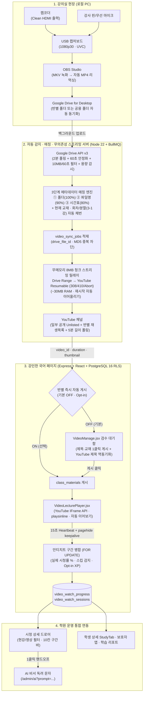

# 수업 영상 자동 파이프라인 (캡처보드 → Google Drive → YouTube → 시청 진도 추적) — 최종 구현 명세 (v2)

> 2026-11-24 작성 (v2 레드팀 감사 14건 + 실 PostgreSQL 16 · Headless Chrome 브라우저 E2E 검증 반영).
> 대상 코드베이스: `my-teaching-assistant` / `academy-manager` (Express `server/` + React `client/`, PostgreSQL 16, Render Standard 2GB).
> **📘 현장용 사용설명서:** [VIDEO_AUTO_PIPELINE_GUIDE.md](./VIDEO_AUTO_PIPELINE_GUIDE.md) (앱 내 `수업 영상 관리 → 사용설명서 · 세팅 가이드` 탭 및 `/admin/guide`에도 동일 통합).
> 실제 Phase 1~5 전체 코드 구현 및 앱 내 사용설명서 통합은 `kare1718/my-teaching-assistant` 로컬 브랜치 `feat/video-auto-pipeline` (`d54bfe5` → `25118e6`, 총 34개 파일, 단위·실 PostgreSQL 16 HTTP/워커 E2E 16/16 통과, SQL 테넌트 감사 0경고, 프론트엔드 10파일 ESLint 0에러, Vite 프로덕션 빌드 통과, Playwright Headless Chrome UI E2E 전 항목 통과)에 완료되어 있다.
>
> **✅ 확정 방향 (2026-11-24):**
> 1. **유튜브 공개 범위 & 시청 방식:** 유튜브 **`일부 공개(Unlisted)`**로 자동 업로드(검색·채널 비노출, 원본 링크 관리자용 보관). 학생은 강인한 국어 페이지 내 전용 플레이어에서 시청해 진도를 정밀 추적한다. (문자/안내 링크도 유튜브 직접 URL이 아닌 강인한 국어 딥링크 `/student/materials?video=:id`로 발송하며, 미로그인 시 로그인 후 원래 영상으로 자동 복원한다.)
> 2. **제목 · 교재 · 날짜 자동 연동:** 반별 **현재 진행 교재**를 등록해 두고, **① 드라이브 폴더 매핑(100%) → ② 파일명 키워드(90%) → ③ 수업 시간표 + 녹화 시각 ±30분(80%)** 3단계 우선순위로 반·교재·날짜·회차(같은 날 분할 녹화 `3-1강`, `3-2강` 포함)를 자동 조합해 제목을 생성한다.
> 3. **업로드 & 페이지 게시 정책 (Opt-in 원칙 유지):** 구글 드라이브 저장 → 유튜브 업로드는 자동 처리하고, 강인한 국어 페이지는 기본 **`검수 대기함(draft)`**으로 등록 후 원장/조교 **1클릭 게시**. 안정화된 반만 **반별 `즉시 자동 게시` 토글(기본 OFF)**을 켜서 완전 자동화할 수 있다.
> 4. **기존 시스템 통합:** [VIDEO_STUDENT_CLASSIFICATION_PLAN.md](./VIDEO_STUDENT_CLASSIFICATION_PLAN.md)(영상 수강생 `learning_mode = 'video'`) · [AI_SECRETARY_SMS_PLAN.md](./AI_SECRETARY_SMS_PLAN.md)(미완강 학생 AI 비서 독려 문자 원클릭 핸드오프) · 학습 리포트 · 보호자 앱과 시청 진도 데이터를 일원 연동한다.

---

## 1. 구현 가능 여부 & 핵심 기술 검증 요약

**결론: 캠코더 → 캡처보드 → 강의실 PC(OBS) → Google Drive → YouTube `일부 공개(Unlisted)` 자동 업로드 → 강인한 국어 페이지 자동 업데이트(교재명·날짜 연동) → 학생별 시청 여부 및 실제 시청률(%) 추적까지 전 구간 100% 구현 및 검증 완료.**

| 검증 항목 | 현실 제약 | 본 설계·구현의 해결책 |
|---|---|---|
| **유튜브 `비공개` vs `일부 공개`** | 유튜브 `비공개(Private)`는 구글 계정을 최대 50명 이메일로 일일이 초대해야 하며 **링크 시청·웹사이트 임베드 모두 불가** | **`일부 공개(Unlisted)`** 사용 — 검색·채널 비노출을 유지하면서 페이지 내 임베드·진도 추적·관리자용 링크 보관이 모두 가능 |
| **YouTube Data API v3 할당량·심사 (2026-11)** | 과거(2020~2025)에는 미검수 프로젝트 강제 비공개 잠금 + 일 6건 제한이 있었음 | **2026년 6월·10월 개편**으로 `videos.insert` 별도 버킷 **일 100건 무료** 및 미검수 프로젝트도 기본 할당량 내 `unlisted` 업로드 허용. **채널 전화번호 인증**(15분 초과 필수) + **OAuth 프로덕션 게시**(7일 만료 방지) 필수 |
| **대용량 영상(2~8GB) 서버 OOM & 재시작** | Render Standard(2GB RAM, `SIGTERM` 5초 타임아웃)에서 디스크/메모리 버퍼링 시 즉시 OOM | **무의존성 Node 22 `fetch` 8MB(=32×256KB) 청크 스트리밍 릴레이**(~30MB RAM 고정) + `308 Resume Incomplete` 정상 처리 + `404/410` 세션 재초기화 + `AbortController` 안전 중단 후 서버 재기동 자동 이어올리기 |
| **Google Drive 15GB 용량 폭탄** | 2시간 수업 3.5GB × 주 10강 = 월 **140GB** → 무료 15GB 계정은 3일 만에 포화 | `drive.about.get(storageQuota)` 기반 **85%↑ 용량 경고 배너** 상시 표시 + 유튜브 처리 완료(`succeeded`) 후 **N일 뒤 드라이브 원본 자동 휴지통 이동 Opt-in 옵션(기본 OFF)** + Google One 2TB 가이드 |
| **시청 진도 꼼수 & 외부 이탈** | 단순 `<iframe>`은 재생 위치를 모르고 `max_position`만 쓰면 끝으로 드래그해 100% 조작 가능 | **YouTube IFrame Player API + 10초 단위 안티치트 구간 병합** + PostgreSQL `FOR UPDATE` 행 락 직렬화 + 학생 화면 전용 플레이어·딥링크 로그인 복원 |

---

## 2. 실제 코드베이스 레드팀 감사 & 선행 보강 14건 (+ 실 DB 검증 3건)

초안을 `my-teaching-assistant` 실코드와 전수 대조하고 실 PostgreSQL 16 E2E 테스트를 돌려 발견·봉합한 핵심 수정사항이다.

| # | 영역 · 파일 | 발견된 결함 / 제약 | 적용된 수정 |
|---|---|---|---|
| 1 | `018_rls_policies.sql` · `database.js` | 초안이 `app.current_academy_id`를 가정했으나 실제 함수는 `app_current_academy_id()`(`app.academy_id`)이며, `FORCE ROW LEVEL SECURITY` 적용 시 백그라운드 크론이 0건 반환할 위험 | 8개 테이블 RLS를 `app_current_academy_id()` 규약으로 통일하고, `withAcademyContext(academyId, tx)` 트랜잭션 헬퍼(`set_config('app.academy_id', $1, true)`)로 워커·크론 격리 실행 |
| 2 | `database.js` (`convertPlaceholders`, `pool.max = 5`) | 모든 `?`를 `$N`으로 치환해 JSONB `?` 연산자 사용 시 크래시; `pool.max = 5`라 스트리밍 중 DB 커넥션 점유 시 로그인/출결 마비 | JSONB `?` 연산자 전면 배제; 네트워크 청크 전송은 트랜잭션 밖에서 실행하고 청크 완료 시 단발 풀 쿼리만 수행; 헬스체크 타이머 `.unref()` |
| 3 | `001_initial_schema.sql` (`xp_logs`, `student_characters`) | `xp_logs`에 `reference_id`가 없고 학생 XP는 `students.xp`가 아닌 `student_characters(xp, points, level)`에 저장 | `video_watch_progress.xp_awarded_at` 원자적 락(`WHERE xp_awarded_at IS NULL RETURNING id`) + `student_characters` 레벨 재계산 연동 |
| 4 | `server/middleware/auth.js` | Google OAuth 콜백(`/api/videos/oauth/callback`)은 `Authorization` 헤더가 없어 `authenticateToken` 뒤에 두면 100% `401` | 콜백과 `/external-register`를 `authenticateToken` 앞에 마운트하고 HMAC-SHA256 `state`(10분 TTL) + 1회용 `video_oauth_nonces` 행 락 소비로 인증 |
| 5 | `App.jsx` · `LoginPage.jsx` | 미로그인 학생이 딥링크(`/student/materials?video=123`) 클릭 시 `ProtectedRoute`·`RedirectIfLoggedIn`·`LoginPage`가 목적지를 버리고 `/student`로 이동(`BrowserRouter key={authKey}` 리마운트 포함) | 3곳 모두 `?redirect=` 상대경로(`/` 시작, `//` 금지 — Open Redirect 차단) 보존·복원 |
| 6 | `019_permissions.sql` · `seedPermissions.js` | RBAC 5역할 + 레거시 `조교` 권한 분리 누락 | `videos` 신규 리소스 추가; OAuth 연결·설정·API 키는 `requireAdminOnly`(`admin` 전용), 검수/게시/교재는 원장·부원장·강사·조교, 시청 조회는 상담·행정 허용 |
| 7 | YouTube `videos.insert` & `server.js` `SIGTERM` | 업로드 직후 `duration` 미생성, `308` 중간 응답(`res.ok === false`), 세션 만료 `404/410`, `SIGTERM` 5초 강제 종료 | `duration` 3중 확보(`videos.list` 5분 폴링 + Drive `videoMediaMetadata` + 첫 재생 클라이언트 백필), `redirect: 'manual'` + `308` 정상 처리, `404/410` 재초기화, `signalShutdown()` 안전 중단 |
| 8 | Google Drive 15GB 무료 한도 | 월 140GB 녹화 시 3일 만에 동기화 중단 | `drive.about.get` 용량 85% 경고 배너 + Opt-in 04:00 KST 휴지통 정리 크론(기본 OFF) |
| 9 | Drive 계정 ≠ YouTube 브랜드 계정 | 단일 OAuth 토큰으로는 분리 계정 연동 불가 | `video_integrations`에 `drive_*` / `youtube_*` 독립 토큰 컬럼 분리 + 단일/분리 원클릭 연결 모두 지원 |
| 10 | 현장 녹화 엣지 케이스 3종 | 짧은 테스트 클립 업로드, 같은 날 1·2교시 분할 녹화 회차 엇갈림, 삭제 파일 | `< 10MB` / `< 60초` `ignored` 격리(수동 재시도 가능), 같은 날 `3-1강`/`3-2강` 분할 채번, `trashed` 무시 |
| 11 | 모바일(카카오톡 인앱/iOS Safari) · 다중 탭 · JWT 만료 | `playsinline: 1` 누락, 동시 Heartbeat JSONB 덮어쓰기, 2시간 중 JWT 만료 무음 실패 | `playsinline: 1`·`origin`·`rel: 0` 고정, `SELECT ... FOR UPDATE` 행 락 직렬화, `401/403` 인라인 재로그인 경고 배너 |
| 12 | `server/package.json` 의존성 & `express-rate-limit` v8 | `googleapis` 설치 시 170MB 블로트; `keyGenerator`에 `req.ip` 직접 참조 시 v8 `ERR_ERL_KEY_GEN_IPV6` 오류 | Node 22 내장 `fetch` 무의존성 클라이언트(추가 npm 패키지 **0개**); `progressLimiter`를 `academyId + user.id` 전용 키로 분리 + 전역 IP 리미터 제외 |
| 13 | `metadataMatcher.js` PostgreSQL 트랜잭션 | 단일 `pg.Client`에서 `Promise.all` 호출 및 선택 테이블(`class_schedules`) 조회 실패 시 PostgreSQL 트랜잭션 전체 abort | 순차 `await` 실행 + `to_regclass('public.class_schedules')` 선확인으로 트랜잭션 abort 영구 차단 |
| 14 | 기존 `SchoolPage.jsx` · `admin.js` · `SideNav.jsx` · `StudyTab.jsx` · 확장성 | 수동 유튜브 등록 시 `youtube_video_id` 미추출, `draft` 학생 노출 위험, 로컬 PC 업로더 확장 경로 부재 | `POST/PUT /admin/materials` 자동 `youtube_video_id` 추출, `GET /my-materials` `publish_status = 'published'` 강제, `SideNav` `pending_videos` 배지, `StudyTab`/`ParentHome`/`reports` 연동, `POST /api/videos/external-register` 확장 API 완비 |

---

## 3. 전체 End-to-End 파이프라인 아키텍처



---

## 4. 강의실 현장 세팅 가이드 (하드웨어 · OBS · Google Drive)

### 4.1 하드웨어 구성
- **캠코더:** **클린 HDMI(Clean HDMI)** 출력 지원 모델 (`HDMI 정보 표시: 끔`) + 상시 전원 어댑터.
- **캡처보드:** UVC(드라이버 무설치) USB 3.0 캡처보드(Elgato Cam Link 4K / AVerMedia 등).
- **오디오:** 강사 핀마이크/무선마이크 직결 + OBS 필터 `소음 억제(RNNoise)` + `컴프레서`.

### 4.2 OBS Studio 표준 권장 설정

| 항목 | 권장값 | 이유 |
|---|---|---|
| **해상도 / 프레임** | **1920×1080 · 30fps** | 판서 선명도 확보 + 60fps 대비 용량 50% 절감 |
| **인코더 / 비트레이트** | 하드웨어(`NVENC`/`QuickSync`) · **3,500~4,500 kbps** (AAC 128k) | 2시간 수업 ≈ **3.5~4GB** → 기가인터넷 2~5분 내 동기화 |
| **녹화 형식** | **`.mkv` 녹화 + 고급 `자동으로 MP4로 리먹싱` ON** | 정전/튕김 시 파일 손상 0%, 종료 즉시 무손실 MP4 생성 |
| **파일명 형식** | `%CCYY-%MM-%DD_%hh-%mm-%ss` | 녹화 시작 날짜·시각 고정 → 시간표 매칭 정확도 극대화 |

### 4.3 Google Drive 폴더 구조 & 용량 관리
```text
📁 강인한국어_수업녹화/          ← 학원 루트 감시 폴더
├── 📁 계성고_1학년/             ← [1순위] 반 매핑 폴더 (보강·시간 변동도 100% 매칭)
├── 📁 대륜고_2학년/
└── 📁 자동분류_공용/            ← [3순위] 폴더 미선택 시 시간표 자동 매칭
```
- **조기 업로드 차단:** `.mp4`/`.mov`/`.m4v`만 감지 + `md5Checksum`·`size`·`modifiedTime` 연속 2회 폴링(60초) 동일 시에만 업로드 큐 적재.
- **오작동 클립 격리:** `< 10MB` 또는 `< 60초` 테스트 클립은 `ignored`로 자동 격리(관리자가 필요 시 1클릭 수동 업로드 가능).
- **용량 관리:** 월 100~150GB 사용 기준 **Google One 2TB** 권장. 85% 도달 시 관리자 상단 경고 배너 자동 표시 + 원할 경우 *"YouTube 처리 완료(`succeeded`) 후 N일 뒤 드라이브 원본 자동 휴지통 이동"* Opt-in 설정 가능(기본 영구 보관 OFF).

---

## 5. YouTube 공개 설정 · API 보안 · 3단계 매칭 · 안티치트 추적 요약

- **공개 설정:** `status.privacyStatus = 'unlisted'`, `embeddable = true`, `selfDeclaredMadeForKids = false`. 검색·채널 비노출 + 페이지 내 임베드·진도 추적·관리자 링크 보관 동시 달성.
- **토큰 보안:** `OAUTH_TOKEN_ENCRYPTION_KEY`(32바이트 hex) 기반 AES-256-GCM 암호화 저장, Drive/YouTube 별도 계정·브랜드 채널 분리 지원, OAuth 콜백은 HMAC-SHA256 `state` + 1회용 DB `nonce` 행 락 소비.
- **제목 연동:** `class_textbooks`에서 반별 `현재 진행 교재(is_current)` 관리 → `[{MM}/{DD}({요일})] {교재명} - {반명} ({회차}강)` 자동 렌더링. 같은 날 1·2교시 분할 녹화는 기본 `(3-1강)`, `(3-2강)`(설정에서 연속 채번 전환 가능). 검수 대기함에서 제목 수정 후 `[게시]` 시 `youtube.videos.update`로 유튜브 제목도 자동 역동기화.
- **안티치트 진도 추적:** 15초 Heartbeat + `pause`/`ended`/`visibilitychange`/`pagehide` `fetch(keepalive: true)`. `deltaVideo <= min(wallElapsedSec * min(playbackRate, 2.0) + 4, 60)` 범위의 연속 재생만 `watched_segments`에 병합(`SELECT ... FOR UPDATE`). 끝으로 드래그 시 `skip_flag = true` 적발 + 관리자 드로어에 **10칸 시청 구간 히트맵 바** 표시.

---

## 6. 구현 파일 인벤토리 (`my-teaching-assistant`, 브랜치 `feat/video-auto-pipeline`, 커밋 `d54bfe5` · `25118e6`, 총 34개 파일)

| 레이어 | 신규 / 수정 파일 | 핵심 역할 |
|---|---|---|
| **DB · 권한** | `server/db/migrations/033_video_auto_pipeline_and_watch_tracking.sql`, `server/db/database.js`, `server/db/seedPermissions.js` | `class_materials` 확장 + 6개 신규 테이블 + 8개 테이블 RLS(`app_current_academy_id()`), `withAcademyContext`, `videos` RBAC 리소스 |
| **파이프라인 엔진** | `server/utils/videoProgress.js`, `server/services/videoPipeline/{cryptoUtil,googleClient,tokenService,metadataMatcher,driveWatcher,uploadWorker}.js` | 안티치트 구간 병합, AES-256-GCM/HMAC, 무의존성 8MB 스트리밍(`308`/`410`/`SIGTERM`), 3단계 매칭, 2분 감시, 5분 길이 폴링, Opt-in 정리 |
| **백엔드 API** | `server/routes/videos.js`, `server/routes/{students,admin,parentApp,reports,aiAssistant}.js`, `server/server.js`, `server/services/cronJobs.js`, `server/.env.example` | OAuth(브랜드 채널·연결 해제)·Drive URL 자동 ID 파싱·교재·폴더·수동 등록/수정·검수·게시·진도 Heartbeat(`student_id` 전용 리미터)·현황·외부 업로더 확장 API 및 기존 라우트/크론/종료 훅 통합 |
| **프론트엔드 UI · 사용설명서** | `client/src/utils/videoFormat.js`, `client/src/components/{VideoLecturePlayer,VideoSetupGuide}.jsx`, `client/src/pages/student/Materials.jsx`, `client/src/pages/admin/{VideoManage,UserGuide,AIAssistant}.jsx`, `client/src/App.jsx`, `client/src/pages/LoginPage.jsx`, `client/src/components/SideNav.jsx`, `client/src/pages/admin/StudentTabs/StudyTab.jsx`, `client/src/pages/parent/ParentHome.jsx`, `docs/VIDEO_AUTO_PIPELINE_GUIDE.md` | 전용 추적 플레이어, 학생 교재/미완강 필터 & 딥링크 로그인 복원, 관리자 4-KPI + 5탭 워크스페이스(수동 등록/수정 모달·브랜드 채널·실시간 제목 미리보기·10칸 구간 드로어·AI 비서 핸드오프·앱 내 인터랙티브 6단계 사용설명서), `/admin/guide` 통합 안내, 인쇄용 마크다운 사용설명서 |
| **자동 검증** | `server/tests/video-pipeline.test.js` (`npm run test:video`) | 단위 7건 + 실 PostgreSQL 16 HTTP/워커 전체 파이프라인 E2E 9건 (총 16건) |

---

## 7. 전 단계 구현 및 실 PostgreSQL 16 · Headless Chrome E2E · 빌드 검증 완료 보고

| 검증 항목 | 검증 대상 / 실행 명령 | 결과 |
|---|---|---|
| **DB 마이그레이션 & RLS 멱등성** | `001`~`030` + `033_video_auto_pipeline_and_watch_tracking.sql` 실 PostgreSQL 16.15 적용 + `033` 2회 연속 실행 + `pg_tables.rowsecurity` 확인 | **31개 마이그레이션 완료 · `033` 2회 멱등 PASS · 8/8 테이블 `rowsecurity = true`** |
| **단위 테스트 (7건)** | `npm run test:video` (`videoProgress`, `metadataMatcher`, `cryptoUtil`, `googleClient` Mock `308`/`410`/`Abort` 이어올리기) | **7/7 PASS** |
| **실 PostgreSQL 16 HTTP·워커 E2E (9건)** | `DATABASE_URL=... npm run test:video` (RBAC 403/200, 폴더 기본 `auto_publish=false`, `draft` 미노출/IDOR, 타반 403/타학원 404, 스킵 `skip_flag=true`, 병렬 Heartbeat `FOR UPDATE` 직렬화 & 30XP 1회 지급, 드로어/보호자/리포트, Drive URL 추출·수동 등록·수정·NaN 400, HMAC/nonce 리플레이 차단, Drive 2회 안정화→10MB 격리→retry 매칭→YouTube 업로드/재생목록/길이폴링/Opt-in 정리) | **9/9 PASS (총 16/16 통과, 0 실패)** |
| **멀티테넌트 정적 SQL 감사** | `cd server && npm run audit:queries` | **신규·수정 라우트 경고 0건 (exit code 0)** |
| **프론트엔드 ESLint (10파일)** | `npx eslint` (`videoFormat`, `VideoLecturePlayer`, `VideoSetupGuide`, `Materials`, `VideoManage`, `UserGuide`, `StudyTab`, `ParentHome`, `LoginPage`, `App`) | **0 에러 · 0 경고** |
| **프로덕션 번들 빌드** | `cd client && npm run build` (Vite 7.3.1) | **빌드 성공 (16.65s · `VideoManage` 72.73 kB / gzip 17.79 kB, `Materials` 13.62 kB / gzip 5.20 kB)** |
| **Headless Chrome 브라우저 E2E** | Playwright Chromium (`1440×900`) — 관리자 로그인 → 4-KPI & 5탭 → 10칸 드로어 & `스킵 의심` → AI 비서 `?prompt=` 핸드오프 → 실시간 제목 미리보기 → 사용설명서 6단계 체크리스트 → `/admin/guide` 통합 섹션 → 학생 미로그인 딥링크(`/student/materials?video=:id`) 복원 & 플레이어 자동 오픈 + 스크린샷 육안 검수(체크박스·필터 툴바 CSS 보정 포함) | **전 항목 통과 (페이지 에러 0건 · 콘솔 에러 0건)** |

---

## 8. 실운영 착수 전 원장님 준비물 5가지

1. **강의실 PC:** 캡처보드 연결 + OBS Studio(1080p30 · 4,000kbps · MKV→MP4 자동 리먹싱) + Google Drive for Desktop 로그인.
2. **유튜브 채널 전화번호 인증:** 15분 초과 장시간 수업 영상 업로드를 위해 중급 기능 전화 인증 완료.
3. **Google Cloud 프로젝트:** `Google Drive API` + `YouTube Data API v3` 활성화, OAuth 2.0 웹 클라이언트 발급, OAuth 동의 화면 `프로덕션` 게시(7일 만료 방지).
4. **Render 환경변수 4종:** `GOOGLE_OAUTH_CLIENT_ID`, `GOOGLE_OAUTH_CLIENT_SECRET`, `GOOGLE_OAUTH_REDIRECT_URI`, `OAUTH_TOKEN_ENCRYPTION_KEY`(32바이트 hex).
5. **반별 초기 설정:** `수업 영상 관리 > 교재 · 폴더 연동`에서 반별 현재 교재 등록 및 드라이브 폴더 매핑 완료 후 `Google · YouTube 연동` 탭에서 자동 감시 스위치 ON.
